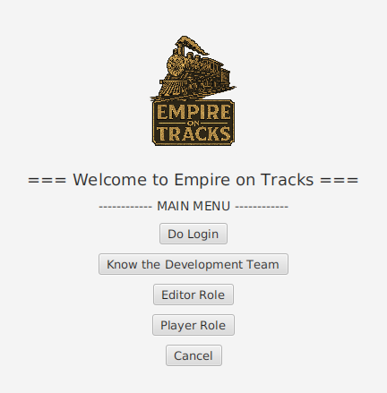
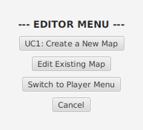
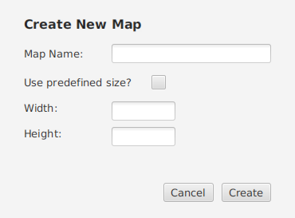
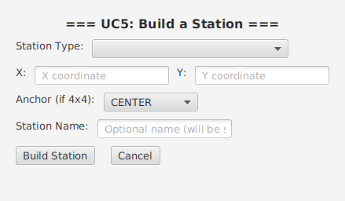
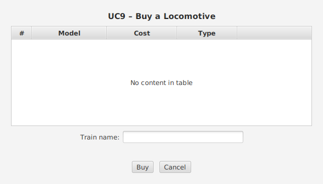
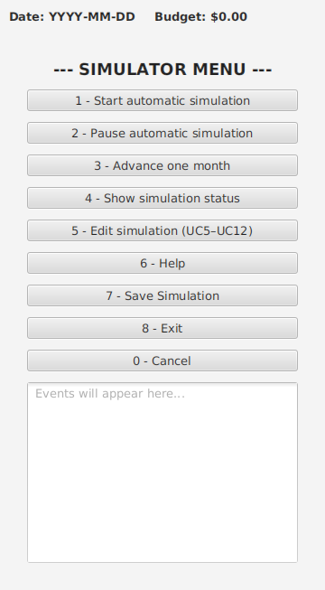
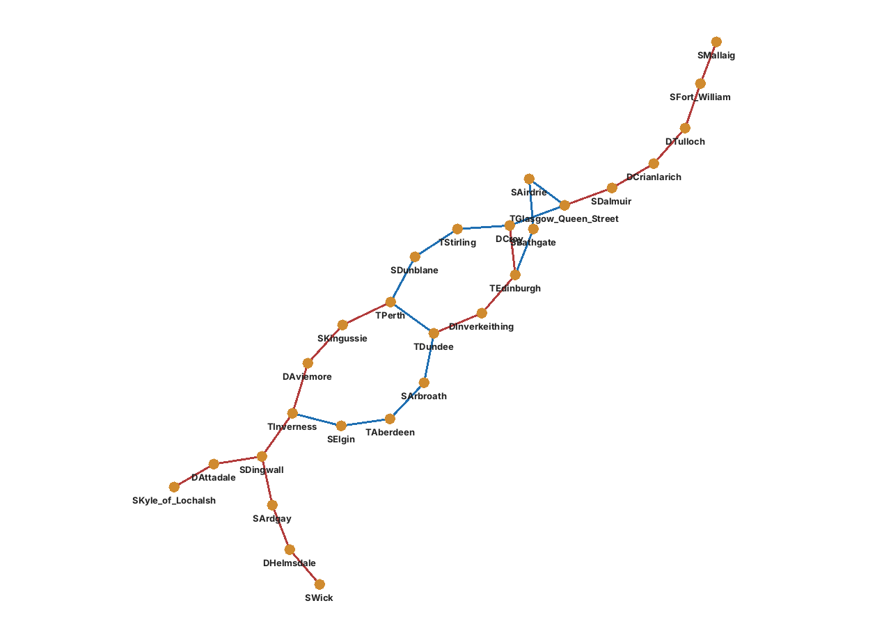
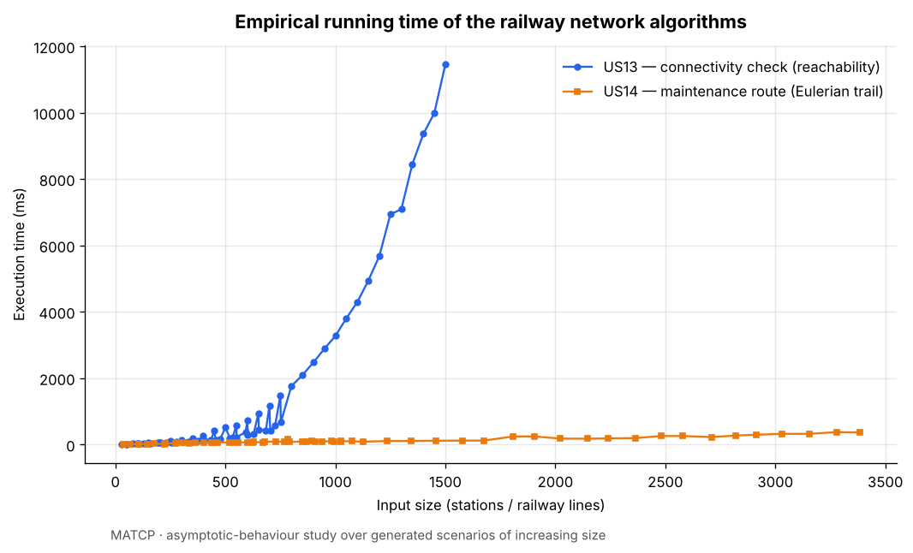

# Empire on Tracks

**A railway-transport management simulator — build the network, move the cargo, grow the empire.**

`Java 21` · `JavaFX 21` · `Maven` · `GraphStream` · `JUnit 5` · `Jupyter / Python (analysis)`



---

## About

**Empire on Tracks** was built as the **2nd-semester Integrative Project (Projeto
Integrador)** of the [Degree in Informatics Engineering (LEI)](https://www.isep.ipp.pt/Course/Course/26)
at [ISEP – School of Engineering, Polytechnic of Porto](https://www.isep.ipp.pt),
academic year **2024/25**. It was developed by a **team of five** over **three
sprints**, following a Scrum-inspired software-development process.

The brief — set by a fictional client, a simulation-game publisher — asked for a
**railroad management simulation**: a game where an *Editor* designs maps and
scenarios (cities, industries, cargo, historical events) and a *Player* then
runs a transport company inside them. Players start with a budget and must build
stations and rail lines, buy locomotives, assemble trains, and schedule routes
that carry passengers, mail and freight between cities and industries — all while
the simulation advances month by month and the budget rises or falls.

The system is delivered as:

- a **JavaFX desktop application** (the main game — Editor and Player roles);
- a **console application** with the same domain and use cases;
- a **graph-analysis tool** for the rail network (connectivity, maintenance
  routes, shortest paths), backed by discrete-mathematics algorithms;
- a set of **statistical and complexity analyses** of the network and its
  algorithms (Jupyter notebooks).

---

## Engineering highlights

- **Layered Java 21 architecture:** domain, controller, repository, mapper/DTO and UI
  layers, with one shared domain driving two front ends: a JavaFX desktop app (FXML
  views + per-screen controllers) and a console app. About 160 classes and 15k lines.
- **Tested domain:** 254 JUnit 5 tests across domain and repository classes, with
  JaCoCo coverage reporting wired into the Maven build.
- **Background simulation loop:** the month-by-month simulation runs on a
  `ScheduledExecutorService`, separate from the UI thread. Updates go back to JavaFX
  via `Platform.runLater`, and the scheduler shuts down cleanly when you leave the screen.
- **Graph algorithms implemented from scratch:** Dijkstra shortest paths, Warshall
  transitive closure for connectivity, and Fleury's algorithm for Eulerian maintenance
  routes, all on adjacency-matrix graphs.
- **Measured, not assumed, complexity:** algorithm runtimes measured on 30 generated
  networks (50 to 1,500 stations), then analysed in Python/Jupyter.
- **Reproducible build:** the Maven Wrapper (no local Maven needed), plus a shaded
  runnable jar and a JavaFX plugin, so the app runs with a single command.

---

## Run it

The project builds with the bundled **Maven Wrapper** (`mvnw`), so you do **not**
need Maven installed — only a JDK. On first run the wrapper downloads Maven and
the project's dependencies.

### Prerequisites

| | Windows | macOS | Linux |
|---|---|---|---|
| **JDK 21** (Temurin recommended) | [Adoptium MSI](https://adoptium.net/temurin/releases/?version=21) | `brew install --cask temurin@21` | `sudo apt install openjdk-21-jdk` (or Adoptium) |
| **Git** | [git-scm.com](https://git-scm.com) | `brew install git` | `sudo apt install git` |
| **Desktop (for the JavaFX app)** | built in | built in | an X11/Wayland desktop session |
| **Maven** | not needed — use `mvnw.cmd` | not needed — use `./mvnw` | not needed — use `./mvnw` |

> JavaFX 21 (LTS) is pulled in automatically as a Maven dependency for your
> platform — there is nothing extra to install.

### 1 — Get the code

```bash
git clone https://github.com/cmmfernandes92/empire-on-tracks.git
cd empire-on-tracks
```

### 2 — Launch the main game (JavaFX)

| OS | Command |
|----|---------|
| macOS / Linux | `./mvnw clean javafx:run` |
| Windows | `mvnw.cmd clean javafx:run` |

### 3 — Or run the console version

```bash
# build once (skips the 3 known-failing legacy tests — see below)
./mvnw -q clean package -DskipTests        # Windows: mvnw.cmd -q clean package -DskipTests
java -cp target/project-template-1.0-SNAPSHOT.jar pt.ipp.isep.dei.Main
```

### 4 — Or run the rail-network graph tool (MDISC)

```bash
java -cp target/project-template-1.0-SNAPSHOT.jar MDISC.Main
```

When prompted, point it at one of the bundled demo datasets, e.g.:

```
Stations CSV: src/main/java/MDISC/files/scenario1_stations.csv
Lines CSV:    src/main/java/MDISC/files/scenario1_lines.csv
Train type:   2   (Diesel — uses all lines)
```

then choose option **3 — Display full network graph**.

### Demo login

The console app pre-registers a demo player on startup:

| Username | Password |
|----------|----------|
| `player1` | `ABC12XY` |

(Passwords follow the brief's rule: 7 alphanumeric characters, 3 uppercase, 2
digits.) The JavaFX app also lets you register a new player or editor from its
menus. No database, server or configuration file is required — all state is kept
in memory or in local save files.

### Run the tests

```bash
./mvnw test
```

**254 automated tests** (JUnit 5). 251 pass; **3 legacy tests fail** and are
left exactly as they were in the original submission. They don't affect building
or running the app.

---

## A quick tour

### Design a world — the Editor

An Editor creates a map, then populates it with cities and industries. Industries
form a supply chain: primary industries (farms, coal mines) feed transforming
industries (steel factories, food processors), which feed cities.





### Build the network & roll out trains — the Player

Players build stations and rail lines, then buy locomotives (steam, diesel,
electric) and compose trains to serve routes within their budget.




### Run the simulation

The simulator advances month by month, applying scenario events and tracking the
budget. It can run automatically or step one month at a time.



### Analyse the network — discrete maths & computational maths

The network is modelled as a graph. The MDISC tool checks connectivity, finds
Eulerian maintenance routes that cover every line, and computes shortest paths,
visualised with GraphStream (electrified lines in blue, non-electrified in red):



The MATCP analysis studies the **asymptotic behaviour** of those algorithms over
generated scenarios of growing size:



---

## What each course contributed

This Integrative Project combines the work of several 2nd-semester LEI courses.
*(Course mapping is inferred from the project's artefacts and folder layout.)*

| Course | Focus | What was built |
|--------|-------|----------------|
| **ESOFT** — Software Engineering | Software-development process, OO analysis & design | Requirements engineering, use-case & domain models, sequence/class diagrams, glossary, FURPS+ supplementary spec, and TDD discipline (see [`docs/system-documentation`](docs/system-documentation)) |
| **LAPR2** — Project / Lab | Implementation of the integrated system | The Java application itself: domain model, controllers, repositories, serialization, and both the JavaFX and console UIs (`src/`) |
| **MDISC** — Discrete Mathematics | Graph theory | Rail-network graph model and algorithms — connectivity/reachability (transitive closure), Eulerian maintenance routes, shortest paths — with GraphStream visualisation (`src/main/java/MDISC`, [`MDISC-docs`](MDISC-docs)) |
| **MATCP** — Computational Mathematics | Statistics & complexity analysis | Descriptive statistics on station data and empirical complexity (asymptotic-behaviour) studies of the MDISC algorithms, in Jupyter notebooks ([`MATCP`](MATCP)) |

---

## Project structure

```
.
├── src/
│   ├── main/
│   │   ├── java/
│   │   │   ├── pt/ipp/isep/dei/      # Main app: domain, controllers, repositories,
│   │   │   │                         # serializer, console UI + JavaFX GUI (Empire on Tracks)
│   │   │   └── MDISC/                # Rail-network graph tool (graph-theory algorithms)
│   │   │       ├── files/            # Demo railway datasets (CSV)
│   │   │       └── files_MATCP/      # Generated scenarios of increasing size
│   │   └── resources/               # FXML views, images, properties
│   └── test/java/                   # JUnit 5 tests (domain + repositories)
├── docs/
│   ├── system-documentation/        # Per-US SDP docs + global artefacts (UML, domain model)
│   ├── template-files/              # Project documentation templates
│   ├── auth/                        # Authentication design (class diagram, domain model)
│   └── screenshots/                 # Screenshots used in this README
├── MATCP/                           # Computational-maths notebooks + data (statistics, complexity)
├── MDISC-docs/                      # Discrete-maths algorithm write-ups (concepts, pseudocode)
├── user-manual/                     # End-user manual (markdown + images)
├── pom.xml                          # Maven build (Java 21, JavaFX, GraphStream, JUnit 5)
└── mvnw, mvnw.cmd, .mvn/            # Maven Wrapper (no local Maven install needed)
```

---

## Documentation

| Folder | What's in it |
|--------|--------------|
| [`docs/system-documentation`](docs/system-documentation) | Software Development Process documentation per User Story — requirements engineering, analysis, design (UML in PlantUML + SVG), tests & implementation — plus global artefacts (use-case diagram, domain model, glossary, supplementary specification) |
| [`docs/template-files`](docs/template-files) | Markdown & UML templates used to produce the documentation |
| [`docs/auth`](docs/auth) | Authentication & authorization design |
| [`MDISC-docs`](MDISC-docs) | Discrete-mathematics write-ups: graph-theory concepts, and pseudocode/complexity analysis of the connectivity (US13) and maintenance-route (US14) algorithms |
| [`MATCP`](MATCP) | Computational-mathematics notebooks: descriptive statistics on station data and the asymptotic-behaviour study of the algorithms, with the datasets used |
| [`user-manual`](user-manual) | End-user manual for the game |
| [`docs/TeamMembersAndTasks.md`](docs/TeamMembersAndTasks.md) | Team and how the work was organised across sprints |

---

## Team

Developed by a team of five LEI students (2024/25):

- Carlos Fernandes
- Dinis Silva
- Fábio Costa
- Gonçalo Silva
- Nuno Cerqueira

---

*This repository is shared as a portfolio piece. All rights reserved by the
authors. The code isn't licensed for reuse, but you're welcome to read, clone and
run it.*
