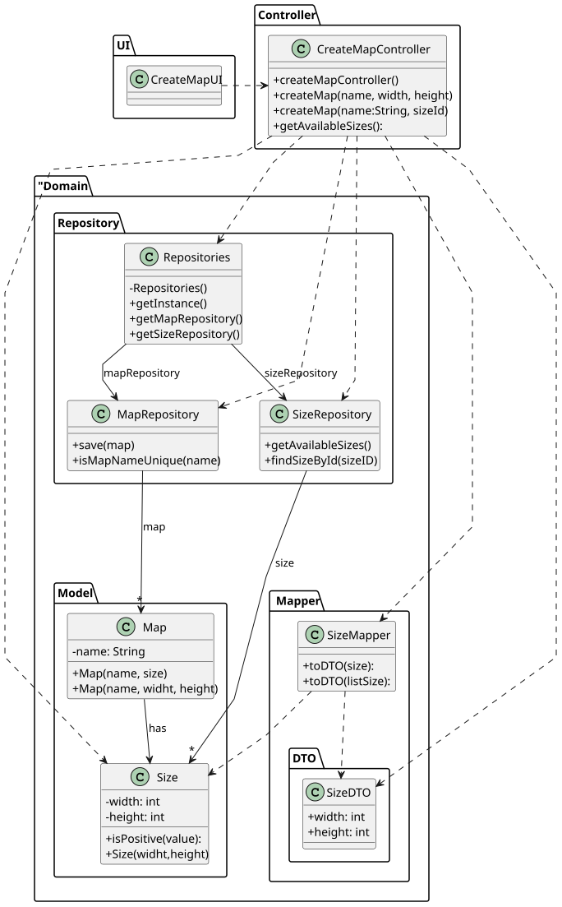

# US001 - Create a Map with a size and a name

## 3. Design

### 3.1. Rationale

| Interaction ID | Question: Which class is responsible for...   | Answer                | Justification (with patterns)                                                                                                |
|:---------------|:----------------------------------------------|:----------------------|:-----------------------------------------------------------------------------------------------------------------------------|
| Step 1         | ... interacting with the actor?               | `CreateMapUI`         | **Pure Fabrication**: UI class created to separate concerns and handle user input/output.                                    |
|                | ... coordinating the use case?                | `CreateMapController` | **Controller**                                                                                                               |
| Step 2         | ... validating map dimensions?                | `Size`                | **Information Expert**: owns width/height values and validates them.                                                         |
| Step 3         | ... knowing all existing Sizes to show?       | `Repositories`        | **Information Expert**: Repositories contains Sizes                                                                          |
|                |                                               | `SizeRepository `     | By applying High Cohesion (HC) + Low Coupling (LC) on class Repositories, it delegates the responsibility on MapRepository . |
| Step 4         | ... converting Sizes to DTOs?                 | `SizeMapper`          | **Pure Fabrication + HC + LC**: isolates transformation logic and decouples domain from presentation/UI layers.              |
| Step 5         | ... Know and save maps?                       | `Repositories`        | **Information Expert**: Repositories contains Maps                                                                           |
|                |                                               | `MapRepository `      | By applying High Cohesion (HC) + Low Coupling (LC) on class Repositories, it delegates the responsibility on MapRepository.  |
| Step 6         | ... checking uniqueness of map name?          | `MapRepository`       | **Information Expert**: knows all stored names and can verify duplicates.                                                    |
| Step 7         | ... confirming final operation with the user? | `CreateMapUI`         | **Pure Fabrication**: prompts user to confirm data before proceeding.                                                        |
| Step 8         | ... instantiating and storing the new `Map`?  | `MapRepository`       | **Creator (Rule 1)**: responsible for creating and persisting new maps.                                                      |
| Step 9         | ... managing predefined sizes?                | `SizeRepository`      | **Information Expert**: owns the set of predefined `Size` entities.                                                          |
| Step 11        | ... informing about operation success?        | `CreateMapUI`         | **Pure Fabrication**: handles the final user feedback message.                                                               |

### Systematization ##

According to the taken rationale, the conceptual classes promoted to software classes are:

* Map
* Size

Other software classes (i.e. Pure Fabrication) identified:

* CreateMapUI
* CreateMapController
* Repositories
* MapRepository
* SizeRepository 
* SizeMapper

## 3.2. Sequence Diagram (SD)

### Full Diagram

This diagram shows the full sequence of interactions between the classes involved in the realization of this user story.

### Class Diagram

