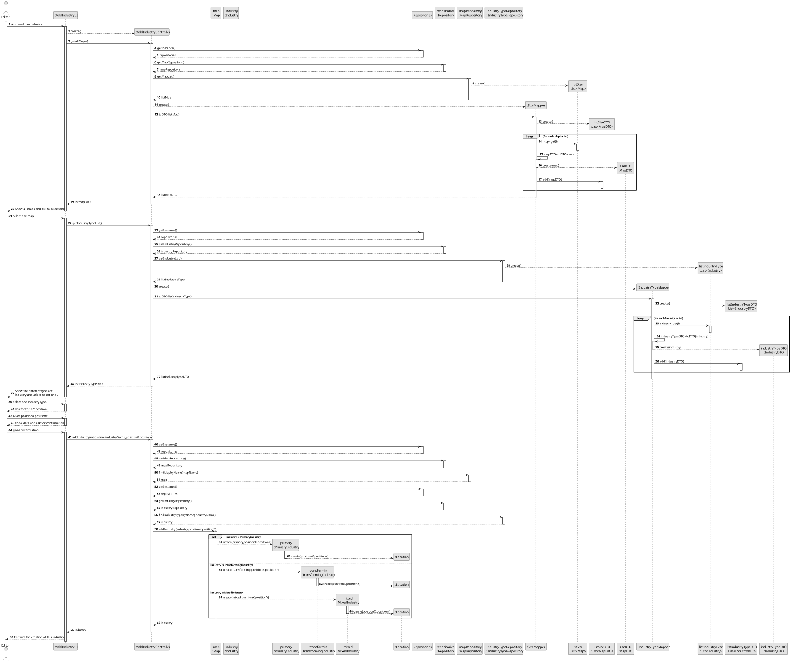
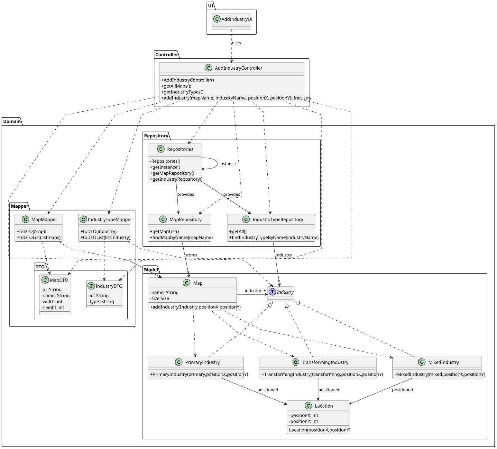

# US006 - Create a Task

## 3. Design

### 3.1. Rationale

| Interaction ID | Question: Which class is responsible for...         | Answer                  | Justification (with GRASP patterns only)                                                                                                                              |
|----------------|-----------------------------------------------------|--------------------------|-----------------------------------------------------------------------------------------------------------------------------------------------------------------------|
| Step 1         | ... interacting with the actor?                     | AddIndustryUI           | **Pure Fabrication**: created solely to manage user interactions, not part of the Domain Model.                                                                       |
|                | ... coordinating the use case?                      | AddIndustryController   | **Controller**: handles the overall use case flow and delegates to specialized components.                                                                            |
| Step 2         | ... knowing all available maps?                     | Repositories            | **Information Expert (IE)**: knows and provides access to specialized repositories.                                                                                    |
|                |                                                     | MapRepository           | **High Cohesion (HC) + Low Coupling (LC)**: by applying HC and LC to the `Repositories` component, map management is delegated to `MapRepository`, which focuses solely on map logic (HC) and minimizes dependencies between unrelated components (LC). |
| Step 3         | ... converting Maps to DTOs?                        | MapMapper               | **Pure Fabrication + HC + LC**: isolates transformation logic and decouples domain from presentation/UI layers.                                                       |
| Step 4         | ... storing the selected map name?                  | AddIndustryUI           | **IE**: retains user-selected data during the process.                                                                                                                |
| Step 5         | ... knowing all available industry types?           | Repositories            | **IE**: provides access to various domain-specific repositories.                                                                                                      |
|                |                                                     | IndustryRepository      | **High Cohesion (HC) + Low Coupling (LC)**: by applying HC and LC to the `Repositories` component, industry type management is delegated to `IndustryRepository`, improving modularity and minimizing coupling with unrelated concerns.                    |
| Step 6         | ... converting Industry to DTO?                     | IndustryTypeMapper      | **Pure Fabrication + HC + LC**: utility class with a single responsibility, reduces coupling and improves maintainability.                                            |
| Step 7         | ... storing selected industry type and coordinates? | AddIndustryUI           | **IE**: responsible for temporarily managing user-provided input.                                                                                                     |
| Step 8         | ... retrieving domain objects from names?           | AddIndustryController   | **LC**: accesses repositories to obtain domain objects while keeping UI and domain layers decoupled from data access logic.                                           |
| Step 9         | ... creating a new Industry?                        | Map                     | **Creator (Rule 2)**: `Map` aggregates `Industry`, so it is naturally responsible for creating it.                                                                    |
|                | ... creating a Location instance?                   | Industry                | **Creator (Rule 1)**: `Industry` directly uses `Location`, so it should create it.                                                                                     |
| Step 10        | ... validating and adding the Industry to the Map?  | Map                     | **IE**: knows its structure and business rules for accepting industries.                                                                                              |
| Step 11        | ... showing confirmation to the user?               | AddIndustryUI           | **IE**: responsible for presenting results and feedback to the user.                                                                                                  |

### Systematization ##

According to the taken rationale, the conceptual classes promoted to software classes are:

* Industry
* location

Other software classes (i.e. Pure Fabrication) identified:

* AddIndustryUI
* AddIndustryController
* Repositories
* IndustryTypeRepository
* MapRepository
* MapMapper
* IndustryTypeMapper

## 3.2. Sequence Diagram (SD)

### Full Diagram

This diagram shows the full sequence of interactions between the classes involved in the realization of this user story.

## 3.3. Class Diagram (CD)

