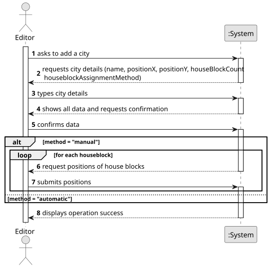

# US003 - Add a City

## 1. Requirements Engineering

### 1.1. User Story Description

As an Editor, I want to add a city in a position XY of the selected map, with a name and a positive number of house blocks.

### 1.2. Customer Specifications and Clarifications 

**From the specifications document:**

>   Indicate the position XY.
>	City must have a name and a positive number of house blocks. 

**From the client clarifications:**

> **Question:** Is it possible for a city to be destroyed by a natural disaster or a war? If so, is it necessary to create a mechanism to remove the city from the map and create a new one to transfer the active elements from the first one(people, mail, ...)?

> **Answer:** A city can be removed in edit mode, but not in simulation mode.  

> **Question:** Is there a minimum or maximum number of house blocks that can be assigned?

> **Answer:** The number needs to be a positive on; there is no maximum, it's up to the editor to decide. 

> **Question:** De acordo com a User Story 3, senhor cliente, o nome da cidade pode apresentar espaços na sua nomenclatura? De acordo com a User Story 3, os blocos de casas podem ser atribuídos manualmente (pelo editor) ou automaticamente de forma aleatória em torno da posição da cidade? De acordo com a User Story 3, o nome da cidade deve ser exclusivo dentro do mesmo mapa? Caro cliente, deve ser considerado como critério de aceitação que o mapa deve ser atualizado visualmente para mostrar a cidade que foi adicionada previamente ao respetivo mapa e os seus blocos de casas? 

> **Answer:** sim pode, "Torres Novas" por exemplo. entretanto já esclarecido no enunciado. Pode ser repetido mas pode tornar-se confuso para os jogadores, o editor deve ser alertado da situação. Ainda não existem especificação para interfaces de utilizador.

> **Question:** 1. What is the purpose and meaning of the "City Tag"? 2. Does the city have a specific radius for some functionality or is the city creation just figurative? 3. Does that influence passenger statistics or will there be no statistics for a specific city 

> **Answer:** 1. It's a label that would appear in the map if a GUI is considered. 2. No, it's the center, that can be useful if the positions for the House Blocks as randomly generated. 3. The statistics will about stations and the railroad network not about cities.

> **Question:** We need some clarification about cities: What exactly are "cities"? Are they entities that automatically produce people and mail based on the total number of house blocks, or do we also need to consider whether the house blocks themselves are located within the economic radius of a station? Is it possible to place a station inside a city without touching any house blocks, resulting in no production? When the editor creates a city, what is the radius within which house blocks can be placed? Is there a minimum and/or maximum number of house blocks that can be placed when creating a city?

> **Answer:** Cities are places with a name, a location and a number of house blocks. Each house block functions as an industry blocks but generates mail/passengers, and demand mail/passangers and final produts like food or goods. The house blocks will accept and generate cargos when inside the economic radius of a station as other industries. If you consider a normal distribution the probability of being far from the town center becames zero. no;

> **Question:** Regarding the implementation of house blocks in the city map, I need to clarify how these should be positioned: Should house block coordinates be absolute positions on the map, or relative to the city center (e.g., +2,-3 from center)? Are there any constraints we should implement, such as maximum distance allowed between house blocks and city center?

> **Answer:** If you decide to assign positions on editor's decision, it's up to the editor to decide the position ;-)
If you decide to assign positions automatically, you can use a normal distribution. Regarding absolute or relative positions, it is up to you to decide what best suits your needs, keeping in mind the overbuilding restriction.

> **Question:** Should the player be required to define the size of the city (in terms of width and length) before creation?If so, should the total number of house blocks be automatically derived from the area of the city (e.g., a 3x3 city would generate 1 to 8 house blocks, with the central coordinate reserved for the city center)? Or alternatively, should the player only need to select whether the distribution is automatic or manual, and then the system generates the house blocks around the city center without any predefined spatial limit?

> **Answer:** City borders are not part of software requirements. The distribution can be manual or Normal (it's means according to Gaussian curve).

### 1.3. Acceptance Criteria

* **AC1:** A city name cannot have special characters or digits.
* **AC2:** The house blocks can be assigned manually or automatically (randomly around the city tag position accordingly to normal distribution).
* **AC3:** Number of house blocks is positive.

### 1.4. Found out Dependencies

* **US01 - Create a Map** → A city can only be added to an existing map.

### 1.5 Input and Output Data

**Input Data:**

* Typed data:
  * City name
  * positionX
  * positionY
  * Number of house blocks

* Selected data:
    * Manual or automatic house block assignment 

**Output Data:**

* (In)Success of the operation

### 1.6. System Sequence Diagram (SSD)

**_Other alternatives might exist._**

### 1.7 Other Relevant Remarks

* The editor should be alerted when the city has a repeated name.
* House blocks are automatically assigned according to the city center and within a certain radius.  