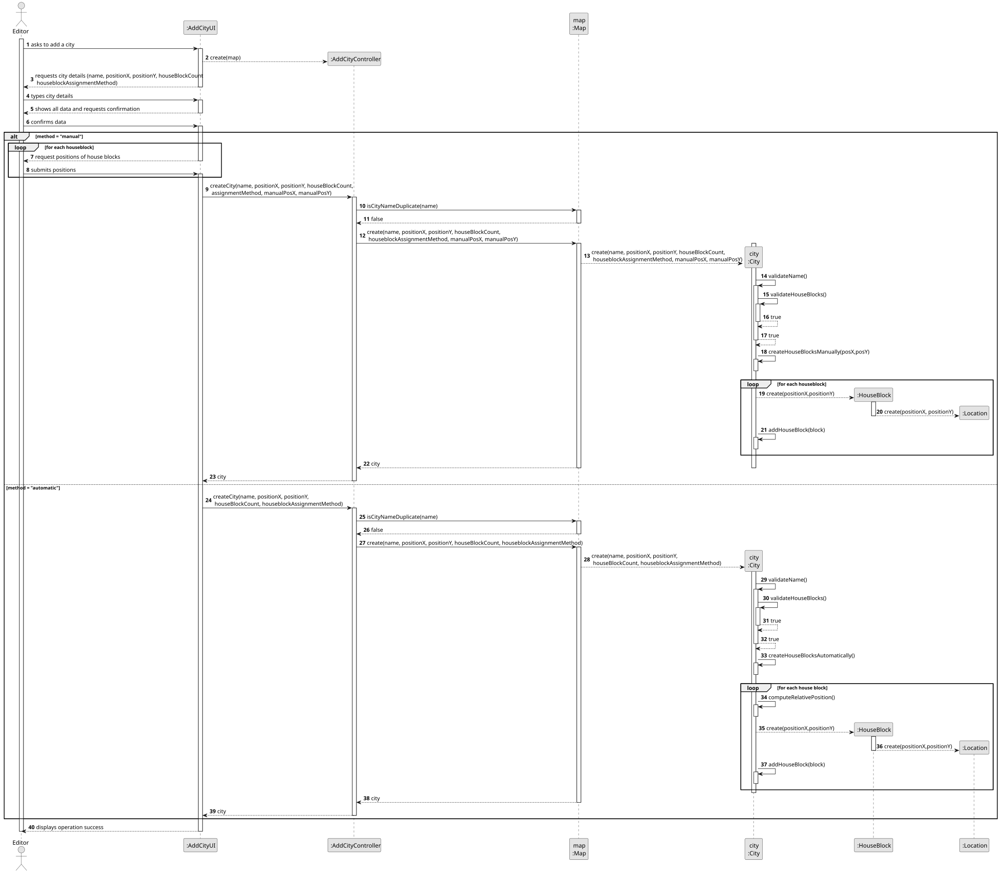
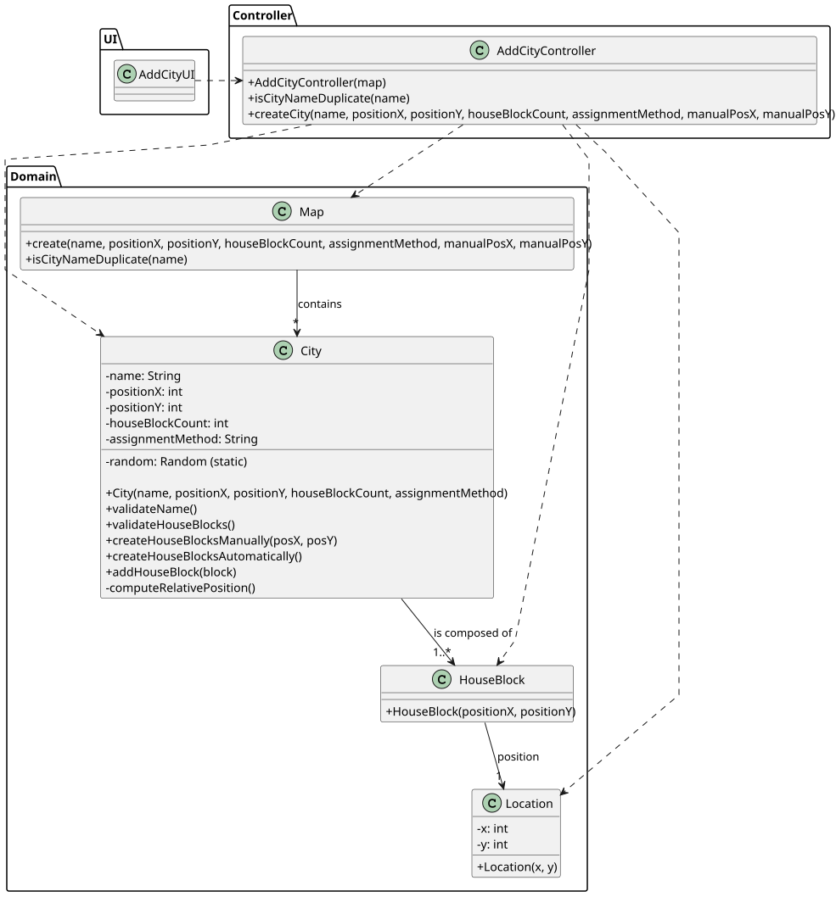

# US003 - Add a City

## 3. Design

### 3.1. Rationale

| Interaction ID | Question: Which class is responsible for...        | Answer                | Justification (with patterns)                                                                                 |
|:---------------|:---------------------------------------------------|:----------------------|:--------------------------------------------------------------------------------------------------------------|
| Step 1         | ... interacting with the actor?                    | AddCityUI             | Pure Fabrication: there is no reason to assign this responsibility to any existing class in the Domain Model. |
|                | ... coordinating the US?                           | AddCityController     | Controller                                                                                                    |
|                |                                                    | Map                   | IE: contains cities                                                                                           |
|                |                                                    | City                  | IE: knows its own data (e.g. name, number of house blocks)                                                    |
| Step 2         | ... validating the city name?                      | City                  | IE: validates its own name (no digits or special characters), per AC1.                                        |
|                | ... validating the number of house blocks?         | City                  | IE: ensures the number of house blocks is positive, per AC3.                                                  |
| Step 3         | ... choosing assignment method?                    | AddCityUI             | IE: responsible for user interaction (manual or automatic selection), per AC2.                                |
|                | ... assigning house blocks (automatic)?            | City                  | IE: responsible for placing house blocks around its center (normal distribution).                             |
|                | ... assigning house blocks (manual)?               | AddCityUI             | IE: responsible for manual assignment of house blocks by the user.                                            |
|                | ... creating house blocks?                         | City                  | Creator: contains house blocks, thus should create them.                                                      |
| Step 4         | ... saving the new city?                           | Map                   | IE: responsible for persisting cities.                                                     |
| Step 5         | ... informing operation success?                   | AddCityUI             | IE: responsible for communicating with the user.                                                              |
| Step 6         | ... showing all data and requesting confirmation?  | AddCityUI             | IE: responsible for presenting city data before final confirmation.                                           |
| Step 7         | ... instantiating a new City?                      | Map                   | Creator (Rule 1): Map contains cities, so it creates them.                                                    |
|                | ... validating all data (local validation)?        | City                  | IE: owns and validates its own data.                                                                          | 
|                | ... validating all data (global validation)?       | Map                   | IE: knows all existing cities (e.g. for warning about duplicate names).                                       |  |
| Step 8         | ... informing operation success?                   | AddCityUI             | IE: responsible for user interactions.                                                                        |

### Systematization ##

According to the taken rationale, the conceptual classes promoted to software classes are: 

* City
* Map
* Location
* HouseBlock

Other software classes (i.e. Pure Fabrication) identified: 

* AddCityUI  
* AddCityController

## 3.2. Sequence Diagram (SD)

### Full Diagram

This diagram shows the full sequence of interactions between the classes involved in the realization of this user story.

### Split Diagrams

The following diagram shows the same sequence of interactions between the classes involved in the realization of this user story, but it is split in partial diagrams to better illustrate the interactions between the classes.

It uses Interaction Occurrence (a.k.a. Interaction Use).

## 3.3. Class Diagram (CD)

