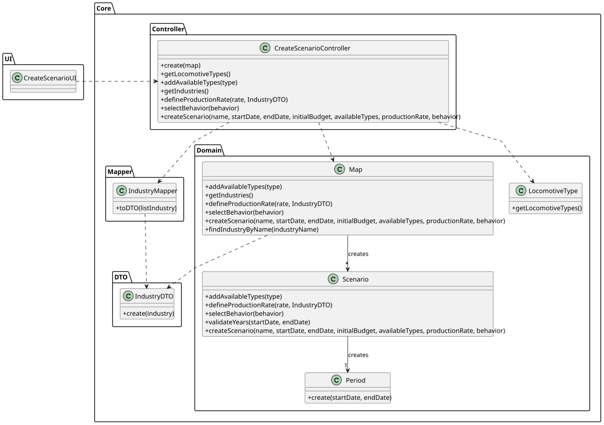

# US004 - Create a Scenario

## 3. Design

### 3.1. Rationale

| Interaction ID | Question: Which class is responsible for...                    | Answer                    | Justification (with patterns)                                                                                   |
|:---------------|:--------------------------------------------------------------|:--------------------------|:----------------------------------------------------------------------------------------------------------------|
| Step 1         | ... interacting with the actor?                                | CreateScenarioUI          | Pure Fabrication: no existing Domain Model class fits; UI handles user communication.                          |
|                | ... coordinating the use case?                                 | CreateScenarioController  | Controller: manages use case flow and business coordination.                                                    |
| Step 2         | ... requesting scenario period (start and end date)?           | CreateScenarioUI          | IE: responsible for requesting user input.                                                                      |
| Step 3         | ... showing all available locomotive types?                    | CreateScenarioUI          | IE: responsible for user interactions.                                                                          |
|                | ... adding each selected locomotive type to the scenario?      | CreateScenarioController  | Controller: coordinates inclusion into the scenario.                                                            |
|                | ... storing/fetching available types?                          | LocomotiveType            | IE: handles data retrieval for locomotive types.                                                                |
|                | ... encapsulating availability logic on each locomotive?       | LocomotiveType            | IE: applies its own availability logic.                                                                         |
| Step 4         | ... showing all available industry options?                    | CreateScenarioUI          | IE: responsible for presenting selection options.                                                               |
|                | ... adding production rates to the scenario?                   | CreateScenarioController  | Controller: coordinates assignment of production rates.                                                         |
|                | ... storing/fetching industry data?                            | Map                       | IE: acts as a facade to retrieve and return industry entities.                                                  |
|                | ... mapping industry data to DTOs?                             | IndustryMapper            | Pure Fabrication: transforms internal domain objects to external DTOs.                                          |
|                | ... holding production rules/values?                           | Scenario                  | IE: domain object that stores production data.                                                                  |
| Step 5         | ... requesting production frequency?                           | CreateScenarioUI          | IE: responsible for collecting user-defined values.                                                             |
|                | ... storing/validating the percentage in the scenario?         | CreateScenarioController  | Controller: coordinates the update of production frequency in the domain object.                               |
| Step 6         | ... confirming all data and invoking persistence?              | CreateScenarioUI          | IE: interacts with the user for confirmation and starts finalization.                                           |
|                | ... persisting the new Scenario?                               | Scenario                  | Creator: encapsulates construction and internal validation before saving.                                       |
|                | ... managing the scenario's lifecycle?                         | Map                       | IE: central component that stores and manages scenario configurations.                                          |
| Step 7         | ... informing operation success?                               | CreateScenarioUI          | IE: responsible for final user feedback.                                                                        |

### Systematization ##

According to the taken rationale, the conceptual classes promoted to software classes are:

* Scenario
* Map
* Period
* Industry
* LocomotiveType

Other software classes (i.e. Pure Fabrication) identified:

* CreateScenarioUI
* CreateScenarioController
* IndustryMapper

## 3.2. Sequence Diagram (SD)

### Full Diagram

This diagram shows the full sequence of interactions between the classes involved in the realization of this user story.

### Split Diagrams

The following diagram shows the same sequence of interactions between the classes involved in the realization of this user story, but it is split in partial diagrams to better illustrate the interactions between the classes.

It uses Interaction Occurrence (a.k.a. Interaction Use).

## 3.3. Class Diagram (CD)

