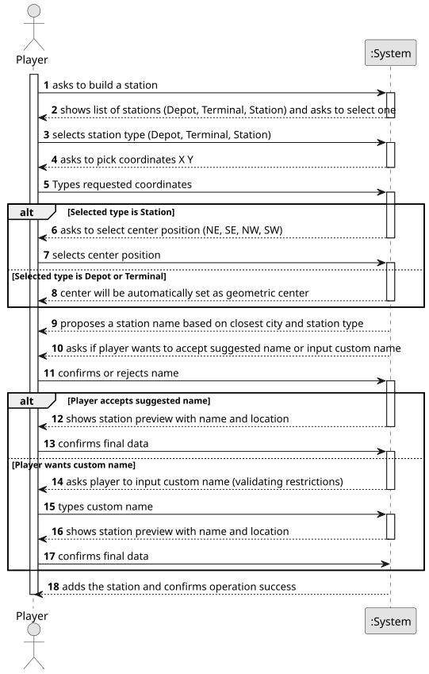

# US005 - Build a station

## 1. Requirements Engineering

### 1.1. User Story Description

As a Player, I want to build a station. 

### 1.2. Customer Specifications and Clarifications 

**From the specifications document:**

>   You can choose between three types of stations with each one having a different size and price, their cost and economic radius distinguish the stations   
>	A station's supply and demand are determined by the industries and population within its radius. By summing their contributions, the station's total business is calculated. 

**From the client clarifications:**

> **Question:** 
> If overbuilding occurs, the program stops running and the game ends or simply gives an error message and asks again for the station construction place?

> **Answer:** 
> Overbuilding in the Editor is possible, the existing building is replaced for the new one.

> **Question:** 
> Should the system provide a user interface for specifying station attributes (station name, type)?

> **Answer:** 
> Overbuilding in the Simulator is NOT possible, the player gets a warning and games continues.

> **Question:** 
> Should users have options to select different station types (Depot, Station, Terminal) based on the game rules?

> **Answer:** 
> No, a player can build depots, stations and terminal as far he has available budget and there no overbuilding.

> **Question:** 
> Is the budget the only concern to build a station, or does the player also needs to have other specific resources, like steel, etc.? Are resources included on the budget, or the budget represent only the player's monetary value?

> **Answer:** 
> Just the budget in a generic currency.

> **Question:**
>What is the input data for the user story 5? Is there any input besides the type of the station?

> **Answer:**
> Position; Station type (Terminal, Station or Depot) and, in the case of the station, the center must be filled in. If the proposed is not accepted an alternative one must be entered.

### 1.3. Acceptance Criteria

* **AC1:** Overbuilding is not possible
* **AC2:** If the user doesn't want the sugested station name he can choose one himself

### 1.4. Found out Dependencies

* There is a dependency on "US01 - Create a map" as there must be a map so that you can place stations

### 1.5 Input and Output Data

**Input Data:**

* Typed data:
    * XY position on the map
    * The center of the station
  
* Selected data:
    * Station Type

**Output Data:**

* List of existing stations
* Shows the chosen location
* (In)Success of the operation

### 1.6. System Sequence Diagram (SSD)

**_Other alternatives might exist._**

### 1.7 Other Relevant Remarks
* the center of the station is only required if the Station Type is "Station"

