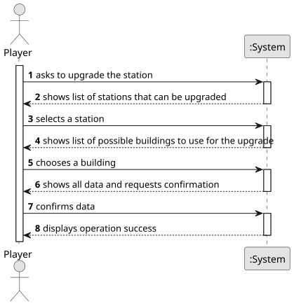

# US006 - Upgrade a station

## 1. Requirements Engineering

### 1.1. User Story Description

As a Player, I want to upgrade a station with a building 

### 1.2. Customer Specifications and Clarifications 

**From the specifications document:**

>	After building a station, you can upgrade it with other buildings that can increase the station's performance, improve train operation, facilitate train manoeuvrers and increase the lifespan of cargo stored at the station 
>	When observing a station, besides the existing buildings, it should also display the cargo awaiting collection and the cargo that requires delivery.

**From the client clarifications:**

> **Question:** 
> In the statement, the example of a small hotel and a large hotel is given as mutually exclusive buildings. Does this mean that all upgrades of the same type are always mutually exclusive? Or, for example, is it possible to have more than one liquid storage unit in the same station?

> **Answer:** 
> There are mutually exclusive buildings, such as a small restaurant and a large restaurant.

> **Question:** 
> No enunciado, é dado o exemplo do small hotel e large hotel como equipamentos mutuamente exclusivos. Isso significa que todos os upgrades do mesmo tipo são sempre mutuamente exclusivos? Ou, por exemplo, é possível ter mais de uma unidade de liquid storage na mesma estação? 

> **Answer:** 
> Existem edícifios mutamente exlusivos como restaurante pequeno e restaurante grande.

> **Question:**  
>* Além disso, gostaria de confirmar se é possível ter múltiplos buildings de tipos diferentes na mesma estação. Por exemplo, podemos ter um small café, um large hotel e um post office simultaneamente?  
>* Caso seja permitido, existe um limite máximo para a quantidade de buildings em cada estação?   
>* Se esse limite existir, ele varia conforme o tipo de estação (Depot, Station ou Terminal)?   
>* Todas as combinações de edifícios são permitidas? Por exemplo, o Player tem liberdade de escolher ter na mesma estação os upgrades: customs + silo + telegraph  

> **Answer:**
>* Existem edificios que quando passam a existir, deixa de ser possivel construir o anterior, por exemplo, o telegrafo foi substituido pelo telefone.  
>* As estações que tenham telegrafo continuam com o telegrafo a funcionar até que seja construido um telefone que substitua o telegrafo. A partir do momento que existe telefone já não é possivel construir um telegrafo.  
>* Não podem existir multiplos edificios iguais (por exemplo, não posso ter 3 silos de cereais)    
>* As combinações, desde que respeitando as restrições anteriomente referidas, são todas possíveis.  

> **Question:**
> Is there a limit on the number of buildings a station can be upgraded with?  

> **Answer:**
> No.

> **Question:**
> Does the upgrade from telegraph to telephone occur automatically once a certain year is reached?

> **Answer:**
> There are no automatic updates; When a new building is available, the player can buy it and then the previous building is replaced.

### 1.3. Acceptance Criteria

N.A.

### 1.4. Found out Dependencies

* There is a dependency on "US01 - Create a map" as there must be a map so that you can place stations and upgrade it
* There is a dependency on "US05 - Build a station" as there must be a station so that you can upgrade it

### 1.5 Input and Output Data

**Input Data:**

* Typed data:
    N/A
	
* Selected data:
    * what station to upgrade 
    * what building to use for the upgrade

**Output Data:**

* List of possible stations to choose from
* List of possible buildings to use for the upgrade
* (In)Success of the operation

### 1.6. System Sequence Diagram (SSD)

**_Other alternatives might exist._**

### 1.7 Other Relevant Remarks

* N/A