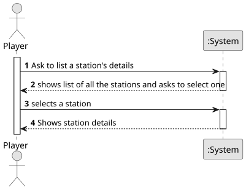

# US007- List all the Stations by Details

## 1. Requirements Engineering

### 1.1. User Story Description

As a Player, I want to list all the stations to select one to see its details, including the existing building and the demand/supply cargoes.

### 1.2. Customer Specifications and Clarifications 

**From the specifications document:**

>	When viewing a station, in addition to the buildings present, the cargo that is ready for collection and the cargo that needs to be delivered should also be displayed. 
 

**From the client clarifications:**

> *Question:* What information should be visible directly in the list? Just the station name, or also other details like type, location, and operational status (active/inactive), etc.?
>
> *Answer:* name and a summary of available cargos to be collected and the ones that are demanded.

> *Question:* Besides the existing buildings and demand/supply cargo, are there any other details that should be shown when viewing a station's information? For example, location, capacity, or operational status?
>
> *Answer:* available cargos to be collected and the ones that are demanded.

> *Question:* When the user selects an existing station, does it automatically show all the associated info to that station or the user selects the station then has to select the required option ? eg: 'show details'.
>
> *Answer:* That's a matter of UX/UI, each team can decide what works best.

### 1.3. Acceptance Criteria

* **AC:** N/A

### 1.4. Found out Dependencies

* There is a dependency on "US005 - Build a station" as there must be at least one station already built to be able to list it.

### 1.5 Input and Output Data

**Input Data:**

* Typed data:
  
	
* Selected data:
    * station

**Output Data:**
* list of stations
* station details
* (In)Success of the operation

### 1.6. System Sequence Diagram (SSD)

**_Other alternatives might exist._**

### 1.7 Other Relevant Remarks

* N/A