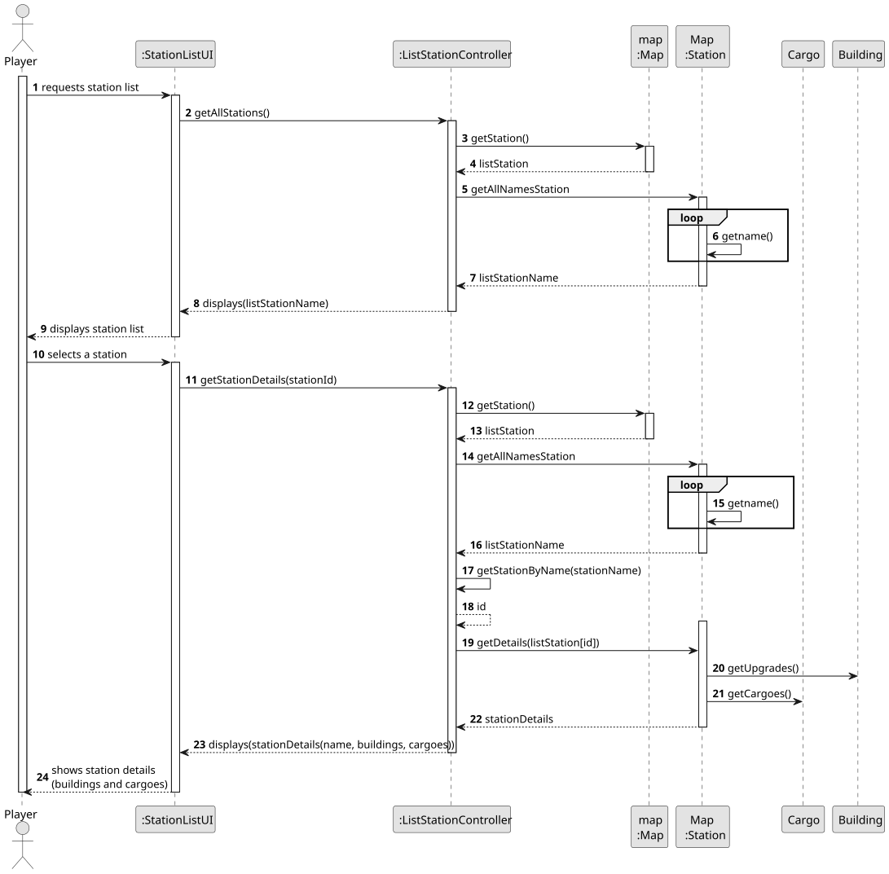
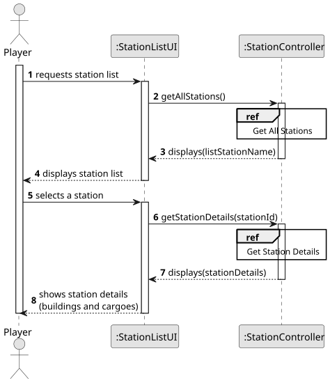
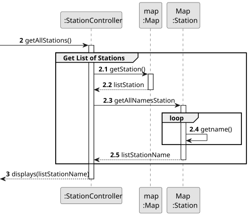
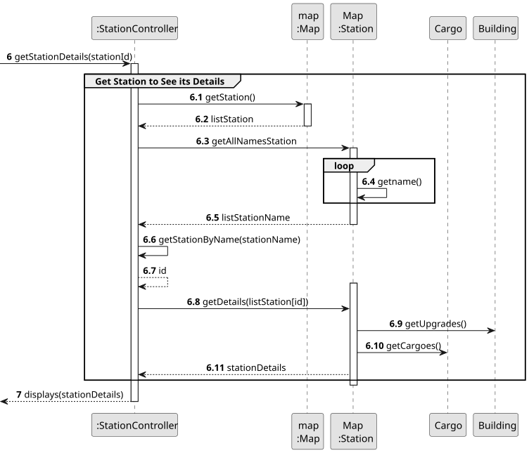
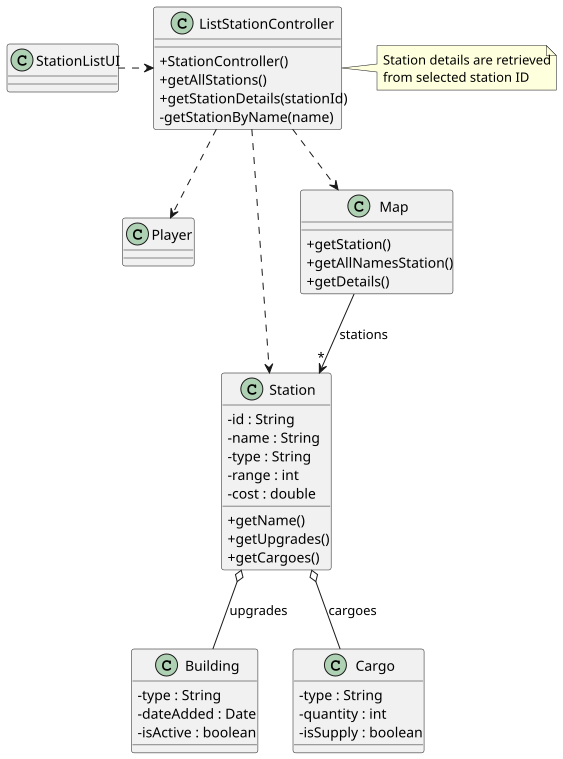

# US007- List all the Stations by Details

## 3. Design

### 3.1. Rationale

| Interaction ID                                                                | Question: Which class is responsible for...    | Answer            | Justification (with patterns)                                                    |
|:------------------------------------------------------------------------------|:-----------------------------------------------|:------------------|:---------------------------------------------------------------------------------|
| Step 1                                                                        | ... interacting with the actor?                | StationListUI     | Pure Fabrication: Dedicated UI class for station listing operations.             |
|                                                                               | ... coordinating the US?                       | StationController | Controller.                                                                      | 
| Step 2                                                                        | ... retrieving raw station data?               | Map               | IE: Acts as root repository for all stations                                     |
|                                                                               | ... extracting station names?                  | Map               | IE: Station instances know their own names (High Coupling(HC) + Low Coupling(LC) |
| Step 3                                                                        | ... displaying the station list?               | StationListUI     | IE: Handles all station display logic                                            |
| Step 4                                                                        | ... fetching detailed station data?            | Map               | IE: Knows its own buildings/cargoes                                              |
|                                                                               | ... retrieving building upgrades?              | Building          | IE: Owns upgrade data                                                            |
|                                                                               | ... retrieving cargo information?              | Cargo             | IE: Manages cargo quantities/types                                               |
| Step 5                                                                        | ... assembling station details?                | StationController | Controller: Coordinates data from Map/Station/Building/Cargo                     |
| Step 6                                                                        | ... displaying full station details?           | StationListUI     | IE: is responsible for displaying information to player                          |              

### Systematization ##

According to the taken rationale, the conceptual classes promoted to software classes are: 

* Player
* Station
* Building
* Cargo

Other software classes (i.e. Pure Fabrication) identified: 

* StationListUI
* StationController
* Map
* PlayerSession

## 3.2. Sequence Diagram (SD)

### Full Diagram

This diagram shows the full sequence of interactions between the classes involved in the realization of this user story.

### Split Diagrams

The following diagram shows the same sequence of interactions between the classes involved in the realization of this user story, but it is split in partial diagrams to better illustrate the interactions between the classes.

It uses Interaction Occurrence (a.k.a. Interaction Use).

**Get All Stations Partial SD**

**Get Station Details Partial SD**

## 3.3. Class Diagram (CD)

