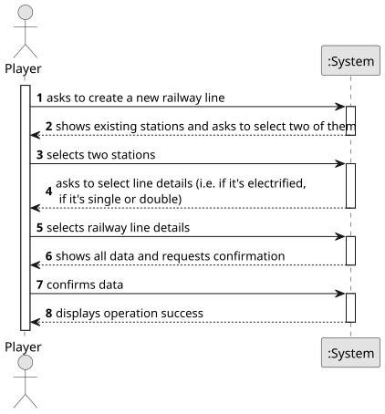

# US008 - Build a Railway Line

## 1. Requirements Engineering

### 1.1. User Story Description

As a Player, I want to build a railway line between two stations.

### 1.2. Customer Specifications and Clarifications 

**From the specifications document:**

>   Railway lines allow the connection between two stations. It is not intended to make a detailed graphical edition of the route, but only a topological representation of the connection between two stations.

>   A line has a certain length, can be single or double, and can be electrified (or not).

**From the client clarifications:**

> **Question:** Does the type of station affect the type of railway lines that can be built?
>
> **Answer:** No.

> **Question:** How are the characteristics (track width, electrification, ...) of the railway lines are requested to the player when creating them?
>
> **Answer:** The line can be single or double; it can also be electrified or not; the distance between two stations S1 and S2, located at positions (x1,y1) and (x2,y2) respectively, can be entered, but the distance cannot be less than the Euclidean distance between the coordinates of the stations.

> **Question:** Can there be redundant railway lines of the same type between the same stations?
>
> **Answer:** There cannot be more than one line between a pair of stations, but the existing line can be upgraded (doubled or electrified) as long as the value of the difference is spentable, electrified (y/n), the minimun distance between this the Manhattan Distance that can be calculated with the formula |x1-x2|.

### 1.3. Acceptance Criteria

* **AC1:**  The player should choose the stations from a list of registered stations.

### 1.4. Found out Dependencies

* There is a dependency on "US005 - Build a Station" as there must be at least two stations already built for one railway to be built.
* There is a dependency on "US001 - Create a Map" as there must be a map for the railway to be built and placed in.
### 1.5 Input and Output Data

**Input Data:**

* Typed data:
    * type of line (double or single, electrified or not)
	
* Selected data:
    * station 1
    * station 2
  
**Output Data:**

* list of types of line
* topological representation of the railway line
* list of registered stations
* (In)Success of the operation

### 1.6. System Sequence Diagram (SSD)

**_Other alternatives might exist._**

### 1.7 Other Relevant Remarks

* N/A