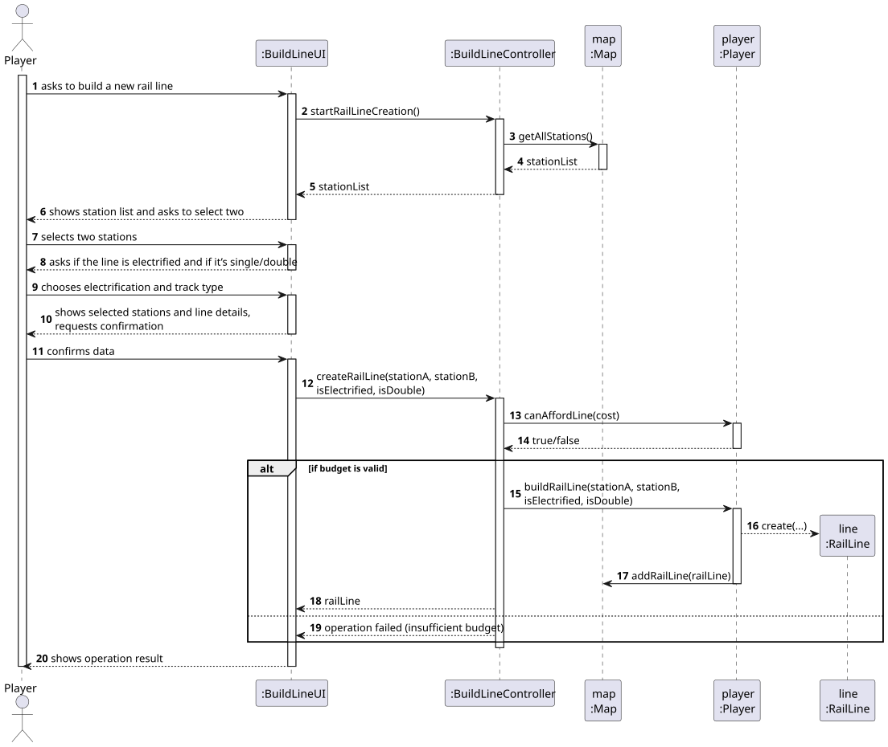
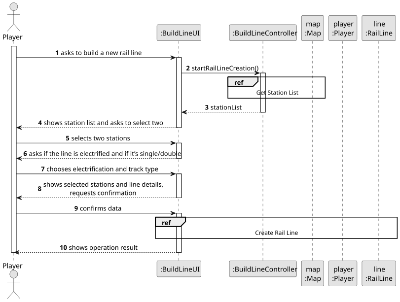
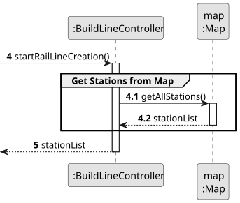
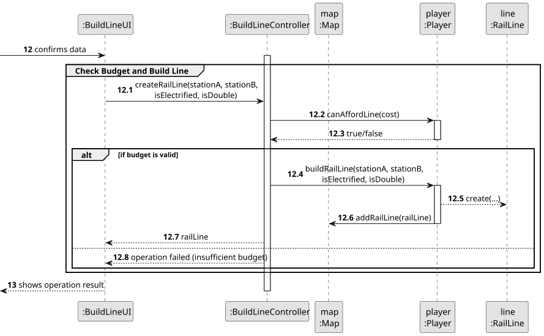
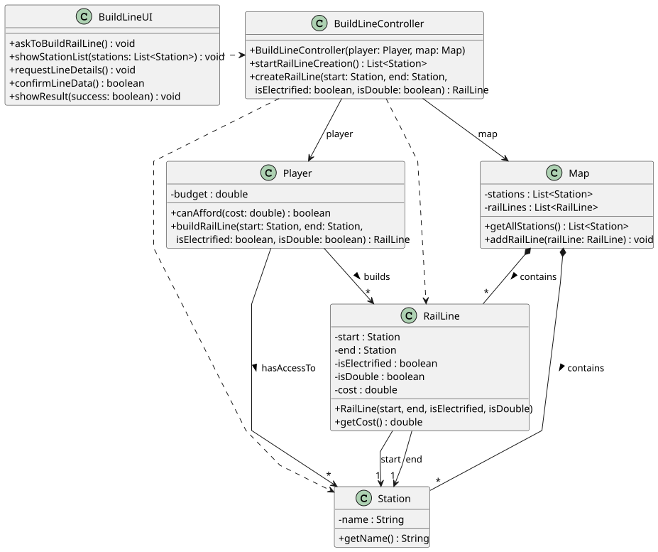

# US008 - Build a Railway Line

## 3. Design

### 3.1. Rationale

| Interaction ID | Question: Which class is responsible for...       | Answer              | Justification (with patterns)                                      |
|:---------------|:--------------------------------------------------|:--------------------|:-------------------------------------------------------------------|
| Step 1         | ... interacting with the player?                  | BuildLineUI         | Pure Fabrication: Avoids coupling domain classes with UI logic     |
|                | ... coordinating the US?                          | BuildLineController | Controller                                                         |
| Step 2         | ... knowing all existing stations to display?     | Map                 | IE: Holds and provides access to all stations                      |
| Step 3         | ... saving the selected stations?                 | BuildLineController | IE: Temporarily holds selections until confirmation                |
| Step 4         | ... requesting line details?                      | BuildLineUI         | IE: is responsible for handling player interaction.                |
| Step 5         | ... saving the inputted line details?             | BuildLineController | IE: Keeps the selected line details before confirmation            |
| Step 6         | ... showing all data and requesting confirmation? | BuildLineUI         | IE: is responsible for displaying summary and confirming operation |              
| Step 7         | ... instantiating a new RailLine?                 | Player              | Creator: In the DM, Player creates RailLine.                       |
|                | ... validating all data (local validation)?       | RailLine            | IE: Validates its own attributes like type and cost                | 
|                | ... validating all data (global validation)?      | Player              | E: Knows current budget to authorize construction                  | 
|                | ... saving the created RailLine?                  | Map                 | IE: Map stores the RailLines it contains                           | 
| Step 8         | ... informing operation success?                  | BuildLineUI         | IE: Handles user feedback and success message display              | 

### Systematization ##

According to the taken rationale, the conceptual classes promoted to software classes are: 

* Player
* Station
* RailLine
* Map

Other software classes (i.e. Pure Fabrication) identified: 

* BuildLineUI 
* BuildLineController

## 3.2. Sequence Diagram (SD)

### Full Diagram

This diagram shows the full sequence of interactions between the classes involved in the realization of this user story.

### Split Diagrams

The following diagram shows the same sequence of interactions between the classes involved in the realization of this user story, but it is split in partial diagrams to better illustrate the interactions between the classes.

It uses Interaction Occurrence (a.k.a. Interaction Use).

**Get Station List Partial SD**

**Get Station List  **

**Get Employee**

**Create Task**

## 3.3. Class Diagram (CD)

