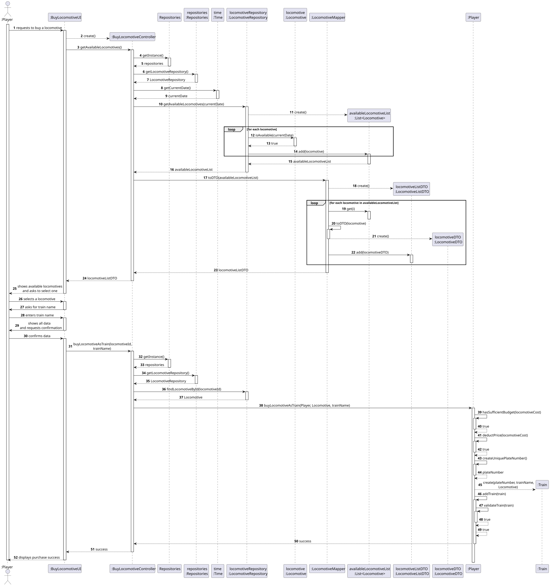
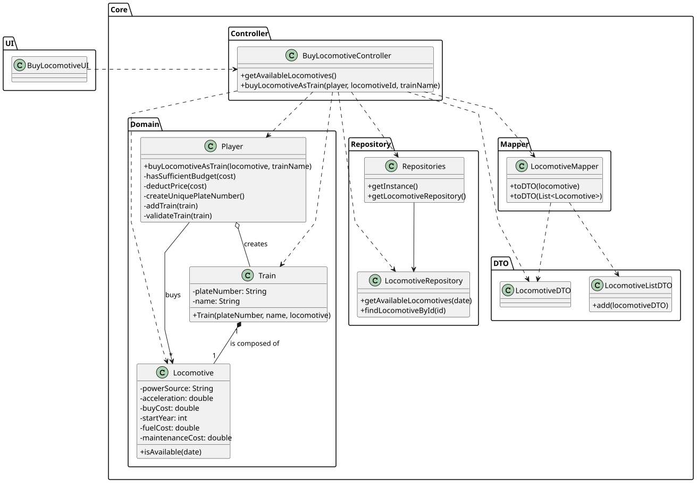

# US009 - Buy a Locomotive

## 3. Design

### 3.1. Rationale

| Interaction ID | Question: Which class is responsible for...                       | Answer                  | Justification (with patterns)                                                                                            |
|----------------|-------------------------------------------------------------------|-------------------------|--------------------------------------------------------------------------------------------------------------------------|
| Step 1         | ...interacting with the actor?                                    | BuyLocomotiveUI         | Pure Fabrication: Handles UI responsibilities, not part of the domain model.                                             |
|                | ...coordinating the user story?                                   | BuyLocomotiveController | Controller: Manages use-case workflow, mediates between UI and domain logic.                                             |
| Step 2         | ...providing list of available locomotives?                       | LocomotiveRepository    | Information Expert (IE): Knows all locomotives and availability (by date/scenario).                                      |
|                |                                                                   | LocomotiveRepository    | By applying **High Cohesion (HC) + Low Coupling (LC)** on class Repositories, task is delegated to LocomotiveRepository. |
|                | ...mapping domain locomotives to DTOs for UI?                     | LocomotiveMapper        | Pure Fabrication: Dedicated to adapting data for the UI, not part of domain logic.                                       |
| Step 3         | ... saving the selected locomotive?                               | BuyLocomotiveUI         | IE: Is responsible for keeping the selected locomotive.                                                                  |
| Step 4         | ... requesting the train name?                                    | BuyLocomotiveUI         | IE: Is responsible for user interactions.                                                                                |
| Step 5         | ... saving the inputted train name?                               | BuyLocomotiveUI         | IE: Is responsible for keeping the inputted data.                                                                        |
| Step 6         | ... showing all data and requesting confirmation?                 | BuyLocomotiveUI         | IE: is responsible for user interactions.                                                                                |
| Step 7         | ...retrieving player's current budget?                            | Player                  | Information Expert: Knows its own budget and resources.                                                                  |
|                | ...checking if purchase can be made (enough funds)?               | Player                  | Information Expert: Only the player knows their budget and spending power.                                               |
|                | ...deducting funds for the purchase?                              | Player                  | Information Expert: Responsible for updating its own budget.                                                             |
|                | ...generating a unique plate number for the new train?            | Player                  | Information Expert & Creator: Knows all owned trains; encapsulates plate logic.                                          |
|                | ...creating the new train (composition of locomotive + metadata)? | Player                  | Creator: Aggregates trains and creates new instances under their ownership.                                              |
|                | ...adding the new train to the player’s owned trains?             | Player                  | IE: Maintains and updates the list of owned trains.                                                                      |
|                | ...validating the newly created train?                            | Player                  | IE: Knows all their owned trains.                                                                                        |
|                | ...persisting the updated player and train ownership data?        | Player                  | IE: Handles persistence of Player domain object.                                                                         |
| Step 8         | ...informing operation success/failure to the player?             | BuyLocomotiveUI         | Pure Fabrication: UI displays outcome to the user.                                                                       |

### Systematization ##

According to the rationale, the conceptual classes promoted to software classes are:

* Locomotive
* Player
* Train

Other software classes (Pure Fabrication) identified:

* :BuyLocomotiveUI
* :BuyLocomotiveController
* :LocomotiveRepository

## 3.2. Sequence Diagram (SD)

### Full Diagram

This diagram shows the full sequence of interactions between the classes involved in the realization of this user story.

## 3.3. Class Diagram (CD)

