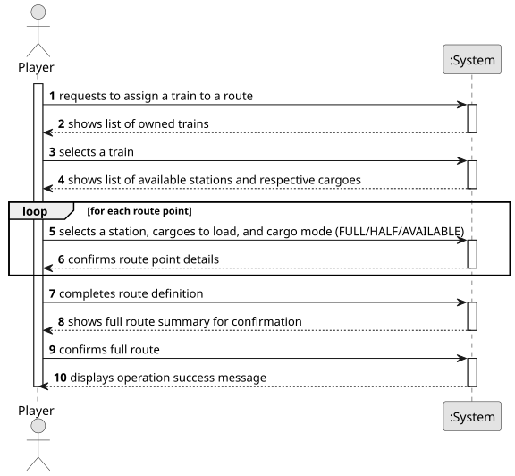

# US010 - Assign a Train to a Route

## 1. Requirements Engineering

### 1.1. User Story Description

As a Player, I want to assign a selected train to a route. A route is a list of Points-of-Route, each Point-of-Route is defined by: a station, a list of cargoes to be picked up.

### 1.2. Customer Specifications and Clarifications 

**From the specifications document:**

> A route is a list of stations where the train passes, along which it loads (carriages) cargo at each station.

> Railway Lines allow the connection of two stations. 

> The carriages are distinguished by the type of cargo they  can transport (e.g., passengers, mail, coal, iron ore, steel, cars) and, in the context of the simulator, they have no acquisition cost.

**From the client clarifications:**

> **Question:** Can multiple cargo types be assigned to the same train?
>
> **Answer:** Yes.

> **Question:** Does a route have a limit of stations that can be assigned?
>
> **Answer:** No.

> **Question:** A route is a list of stations where the train passes. If there is many stations but no railway lines, are we able to create a route?
>
> **Answer:** If there is no path between any pair of consecutive points of the route, the player should be warned, then the player can opt between cancel/proceed.

> **Question:** Does a train collect all the cargo available in a station or just the cargo required for other stations in its route?
>
> **Answer:** It collects the defined in the route if available in the station otherwise it departs with the carriages empty.

> **Question:** When the route of a train is changed in the middle of its previous route, does it finish the route it was currently in or does it immediately start to follow the new one? If the train had cargo obtained from the previous route, what happens to it?
>
> **Answer:** There is no US for changing routes.

> **Question:** Should the route already be defined, with the player choosing from a list of valid routes (a route being a list of stations to pass through), or should the player select the stations one by one after picking the train to assign?
> 
> **Answer:** Each train has an associated route, and a route is a list of pairs (station - carriages to be loaded). There is no need to manage routes independently of trains.

> **Question:** The user selects the list of cargoes to be picked up. Can that cargo only be delivered to the destination station, or can other stations along the route receive parts of it or even the entire cargo when the train arrives at those stations?
> 
> **Answer:** In the Sprint 2 one can consider that the current carriages are all unloaded in the next point of the route.

> **Question:** Does the player have a list of routes to which he can assign trains or does he create a route and have to assign a train to it?
>
> **Answer:** Already answered that question, no need to manage the routes independently from trains, each train has a route.

> **Question:** Can a train have multiple carriages with the same type of cargo? If so, in what scenarios would that happen?
>
> **Answer:** Yes, a train can have multiple carriages of the same cargo, accordingly to example supplied in the text.

> **Question:** Does the train have a limit on the number of carriages?
>
> **Answer:** I suggest 8 or 10, but it doesn't affect the functioning of the proof-of-concept.

> **Question:** If a train is already following a route and a player builds a new railway line, should the simulation update the train's path to find the shortest route? (Considering that the new line might offer a faster route , or not.)
>
> **Answer:** Yes.

### 1.3. Acceptance Criteria

AC01: For each Point-of-Route I want to assign a cargo mode, that can be: FULL (the train only departs when full loaded); HALF (the train departs as soon it haves half of carriages loaded); AVAILABLE (the train departs with available cargoes in the station).

### 1.4. Found out Dependencies

* There is a dependency on **US08 - Build a Railway Line**, as there must be railway lines connecting the stations on the route.
* There is a dependency on **US09 - Buy a Locomotive**, as there must be at least one train owned by the player.

### 1.5 Input and Output Data

**Input Data:**

* Typed data:
    * none
	
* Selected data:
    * a train (from owned trains)
    * stations for route (points-of-route)
    * cargoes to be picked up at each point-of-route
    * number of carriages for each cargo type at each point-of-route
    * cargo mode at each point-of-route

**Output Data:**

* List of available trains
* List of available stations connected by railway lines
* List of available cargoes at the stations
* (In)Success of the operation

### 1.6. System Sequence Diagram (SSD)

**_Other alternatives might exist._**

### 1.7 Other Relevant Remarks

NA