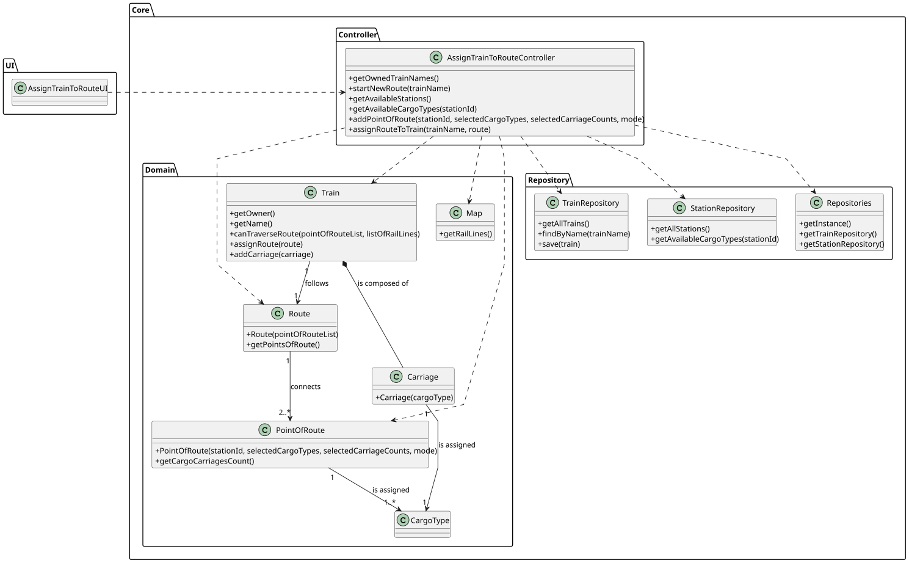

# US010 - Assign a Train to a Route

## 3. Design

### 3.1. Rationale

| Interaction ID | Question: Which class is responsible for...              | Answer                       | Justification (with patterns)                                                                                   |
|:---------------|:---------------------------------------------------------|:-----------------------------|:----------------------------------------------------------------------------------------------------------------|
| Step 1         | ... interacting with the actor?                          | AssignTrainToRouteUI         | Pure Fabrication: no corresponding class in Domain Model; used for user interaction.                            |
|                | ... coordinating the US?                                 | AssignTrainToRouteController | Controller: manages the overall logic and coordinates the system behavior for this use case.                    |
| Step 2         | ... retrieving owned trains?                             | Repositories                 | Information Expert: responsible for persisting trains.                                                          |
|                |                                                          | TrainRepository              | By applying High Cohesion (HC) + Low Coupling (LC) on class Repositories, task is delegated to TrainRepository. |
| Step 3         | ... saving the selected train?                           | AssignTrainToRouteUI         | IE: is responsible for keeping the selected train,                                                              |
| Step 4         | ... retrieving available stations?                       | Repositories                 | IE: responsible for persisting stations.                                                                        |
|                |                                                          | StationRepository            | By applying HC + LC  on class Repositories, task is delegated to StationRepository.                             |
| Step 5         | ... saving selected station?                             | AssignTrainToRouteUI         | IE: UI gathers the player’s choices.                                                                            |
| Step 6         | ... retrieving available cargo at selected station?      | Repositories                 | IE: responsible for persisting and retrieving stations available cargo.                                         |
|                |                                                          | StationRepository            | By applying HC + LC  on class Repositories, task is delegated to StationRepository.                             |
| Step 7         | ... saving selected cargo(es)?                           | AssignTrainToRouteUI         | IE: UI gathers the player’s choices.                                                                            |
| Step 8         | ... requesting number of carriages per cargo type?       | AssignTrainToRouteUI         | IE: responsible for user interaction.                                                                           |
| Step 9         | ... saving number of carriages requested per cargo type? | AssignTrainToRouteUI         | IE: UI gathers the player’s choices.                                                                            |
| Step 10        | ... requesting cargo mode?                               | AssignTrainToRouteUI         | IE: responsible for user interaction.                                                                           |
| Step 11        | ... saving selected cargo mode?                          | AssignTrainToRouteUI         | IE: UI gathers the player’s choices.                                                                            |
| Step 12        | ... creating Point-of-Route?                             | AssignTrainToRouteController | Creator: it has the initializing information to pass it on to creation.                                         |
| Step 13        | ... saving user selection?                               | AssignTrainToRouteUI         | IE: UI gathers the player’s choices.                                                                            |
| Step 14        | ... showing all data and requesting confirmation?        | AssignTrainToRouteUI         | IE: responsible for user interaction.                                                                           |
| Step 15        | ... validating route?                                    | Train                        | IE: Train knows its locomotive type.                                                                            |
|                | ... creating route?                                      | Train                        | Creator: Train contains its Route.                                                                              |
|                | ... assigning a route to the selected train?             | Train                        | IE: Train knows and updates its own route.                                                                      |
| Step 16        | ... informing operation success?                         | AssignTrainToRouteUI         | IE: responsible for user interaction.                                                                           |

### Systematization

**Promoted Domain Classes:**
- Train
- Route
- PointOfRoute
- Station

**Repositories:**
- TrainRepository
- StationRepository

**Pure Fabrication:**
- AssignTrainToRouteUI
- AssignTrainToRouteController

## 3.2. Sequence Diagram (SD)

### Full Diagram

This diagram shows the full sequence of interactions between the classes involved in the realization of this user story.

## 3.3. Class Diagram (CD)

