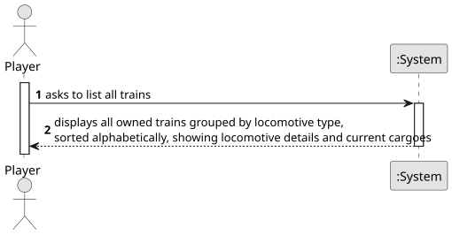

# US011 - List All Trains by Locomotive Type

## 1. Requirements Engineering

### 1.1. User Story Description

As a Player, I want to list all trains.

### 1.2. Customer Specifications and Clarifications 

**From the specifications document:**

>	In the simulator, the player/user acquires trains within the available budget and can put the train into service on a specific route.

>	Trains are composed of locomotives and carriages.

>	The locomotives provide traction to the composition (train) and can be of different types, namely, run by steam, diesel, and electricity.

>	The locomotives are characterized by several technical aspects, such as power, acceleration, top speed, start year of operation, fuel cost and maintenance per year, and acquisition price.

**From the client clarifications:**

> **Question:** On these User Story i want to list all the trains available on the game to buy, or i want to list all the trains that i had already bought?
>
> **Answer:** The ones you bought.

### 1.3. Acceptance Criteria

* **AC1:** The display of trains must include the locomotive and the current cargoes.
* **AC2:** The trains should be grouped by locomotive type and then listed alphabetically by name.

### 1.4. Found out Dependencies

* There is a dependency on **US09 - Buy a locomotive**, as there must be locomotives purchased by the player to list their respective trains.
* There is a dependency on **US10 - Assign a train to a route** for trains to have route/cargoes assigned.

### 1.5 Input and Output Data

**Input Data:**

* Typed data:
    * none
	
* Selected data:
    * request to view the list of purchased trains

**Output Data:**

* List of all trains grouped by locomotive type and sorted alphabetically by name
* For each train: locomotive type, train name, current cargoes
* (optional) Additional train details (route, status, etc.)

### 1.6. System Sequence Diagram (SSD)

**_Other alternatives might exist._**

### 1.7 Other Relevant Remarks

* NA