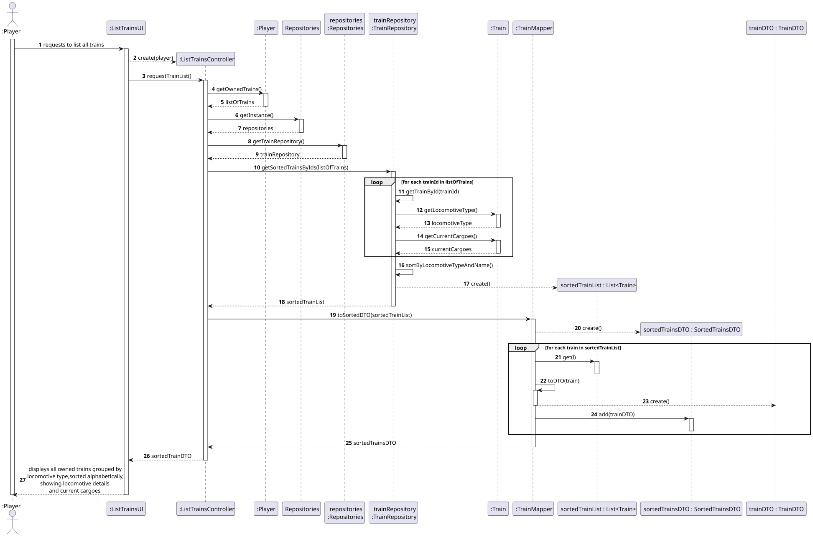
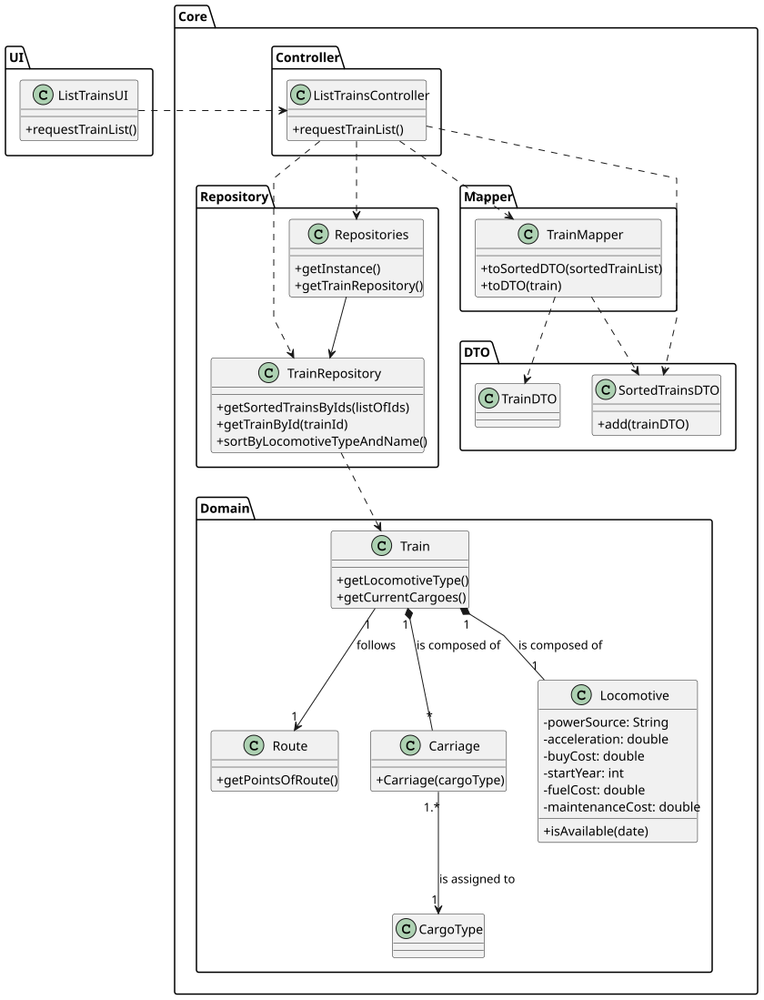

# US011 - List All Trains

## 3. Design

### 3.1. Rationale

| Interaction ID | Question: Which class is responsible for...          | Answer               | Justification (with patterns)                                                                                       |
|----------------|------------------------------------------------------|----------------------|---------------------------------------------------------------------------------------------------------------------|
| Step 1         | ... interacting with the actor?                      | ListTrainsUI         | **Pure Fabrication**: UI layer handles user interaction, not part of domain model.                                  |
|                | ... coordinating the user story?                     | ListTrainsController | **Controller**: Coordinates the flow of the use case.                                                               |
|                | ... knowing the player's owned trains?               | Player               | **Information Expert**: The Player knows the trains they own.                                                       |
|                | ... sorting and grouping trains?                     | Repositories         | **IE**: Repository has access to all trains.                                                                        |
|                |                                                      | TrainRepository      | By applying **High Cohesion (HC) + Low Coupling (LC)** on class Repositories, task is delegated to TrainRepository. |
|                | ... knowing a train’s name, locomotive, and cargoes? | Train                | **IE**: Train knows its name, assigned locomotive, and current cargoes.                                             |
|                | ... knowing the locomotive type of a train?          | Train                | **IE**: Train is composed of a locomotive and knows its type.                                                       |
|                | ... transforming domain trains into DTOs?            | TrainMapper          | **Pure Fabrication**: Handles mapping logic outside of domain and controller layers.                                |
| Step 2         | ...  displaying the train list?                      | ListTrainsUI         | **Pure Fabrication**: Responsible for user interaction.                                                             |

---
### Systematization ##

According to the taken rationale, the conceptual classes promoted to software classes are: 

* Player
* Train

Other software classes (i.e. Pure Fabrication) identified: 

* ListTrainsUI  
* ListTrainsController

## 3.2. Sequence Diagram (SD)

### Full Diagram

This diagram shows the full sequence of interactions between the classes involved in the realization of this user story.

## 3.3. Class Diagram (CD)

