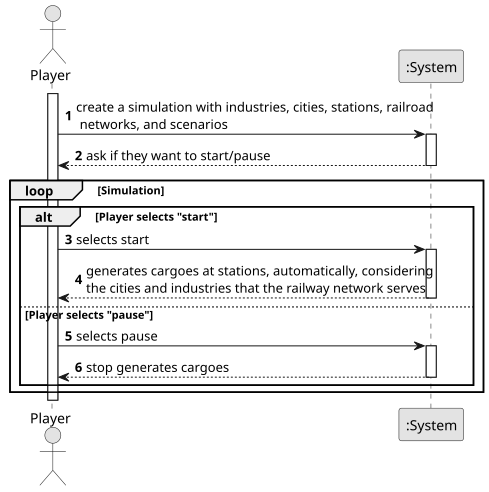

# US012 - Operate a Simulation

## 1. Requirements Engineering

### 1.1. User Story Description

As a Product Owner, I want to create a simulator that generates
cargoes at current stations, automatically, considering the cities and
industries that the railway network serves.

### 1.2. Customer Specifications and Clarifications 

**From the specifications document:**

> Simulation tool that will allow the user to define and interact with the operation of a railway network (including lines, stations, and trains) in the context of a map/scenario
>
>  In addition to creating the dynamic elements already described, the player/user can play or pause the simulator. During the simulator’s operation, the evolution of events should be displayed, namely the trains’ journeys (start and end).
>In the simulation the following values should be considered, further values like locomotives costs and cargos deliver values should be checked in game documentation (previously referred):

**From the client clarifications:**

> **Question:** A simulação é corrida mapa a mapa ou para todos os mapas existentes?
Exemplo: Escolhe correr isoladamente a simulação no mapa da cidade de Lisboa mas não corre no mapa de Paris.
>
> **Answer:** No contexto da simulation o jogador escolhe um cenário para jogar, associado ao cenário existe obrigatoriamente um mapa.

> **Question:** There is a limit to cargo storage?
> 
> **Answer:** 24

> **Question:**  How should cargo generation be done? At fixed time intervals or based on specific events (train arrival)?
>
> **Answer:** accordingly to the frequency defined for the industry and house blocks by the station (the distribution along the year can be fixed or random)

> **Question:** Should the simulator run in real-time or in set intervals?
>
> **Answer:** Not in real-time

> **Question:**  Can users manually adjust cargo generation rates?
> 
> **Answer:** Maybe not the player but generation should be configurable (maybe in a config file).

> **Question:**  Should generated cargo be influenced by train schedules?
> 
> **Answer:** There are no train schedules!

> **Question:** Should cargo generation dynamically update as the railway network expands or changes?  
> 
> **Answer:** Yes; the generation is done for the industries and house blocks served by the stations present in the network.

> **Question:** Will the user have customization options for cargo generation rules, or will it be fully automated?  
> 
> **Answer:** Just in the edition of the scenario.

> **Question:** How should cargo stockpiling be managed at stations to prevent excessive accumulation?  
>
> **Answer:** A maximum number can be considered per cargo type (e.g., 30).

### 1.3. Acceptance Criteria

* **AC1:** This simulator should provide options for start/pause.
* **AC02:** The simulator needs to model train departures. At the time of
  departure, the time of arrival is calculated. The trains travels at the
  maximum speed of the locomotive on double track sections and at 80%
  of the maximum speed of the locomotive on single track sections. Each
  carriage degrades 5% of the locomotive’s speed up to a maximum of
  30%.
* **AC03:** The simulator needs to model train arrivals. On arrival, the
  amount to be received is calculated according to demand and the distance between the departure and arrival stations. The existing building
  in the station that affect revenues from passengers need to taken into
  account.
* **AC04:** The simulator needs to provide a message alerting when a new
  locomotive becomes available, accordingly to its start year of service.
  After that it becomes possible acquire that locomotive model.
*  **AC05:** The simulator needs to generate cargoes in the stations accordingly to the House Blocks and Industry facilities served by each
  station. The number of cargoes depends in each industry type and in
  the modification rates defined in the scenario.
*  **AC06:** The simulator needs to update the demand in station every year
  based in the deliveries.
* **AC7:** Limit to cargo storage

### 1.4. Found out Dependencies

* There is a dependency on "US001" - "Create a map"  a map must be provided to run the simulation.
* There is a dependency on "US002" - "Add an industry"  A industy must exist to consume and/or generate resources.
* There is a dependency on "US003" - "Add a City"  a city must exist to generate people and consume resources
* There is a dependency on "US005" - "Build a station"  A station must exist to receive/send resources
* There is a dependency on "US008" - "Build a station"  A station must exist to receive/send resources

### 1.5 Input and Output Data

**Input Data:**

* Typed data:
    * a map
    * scenario
    * start/pause
	
* Selected data:
    * 

**Output Data:**

* Updated map
* (In)Success of the operation
* pause/start message

### 1.6. System Sequence Diagram (SSD)

**_Other alternatives might exist._**

### 1.7 Other Relevant Remarks

* The created task stays in a "not published" state in order to distinguish from "published" tasks.