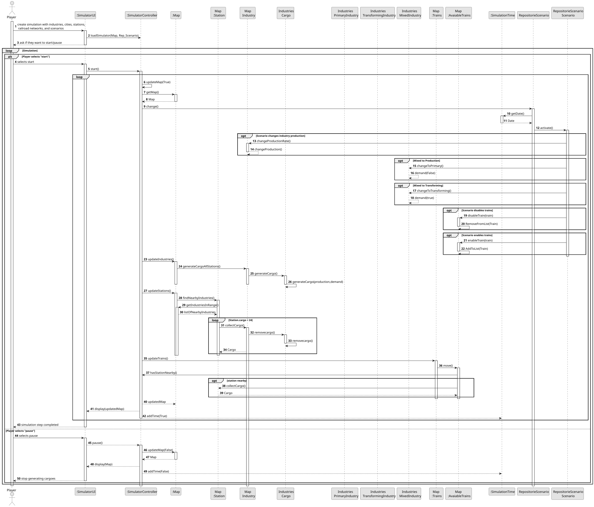
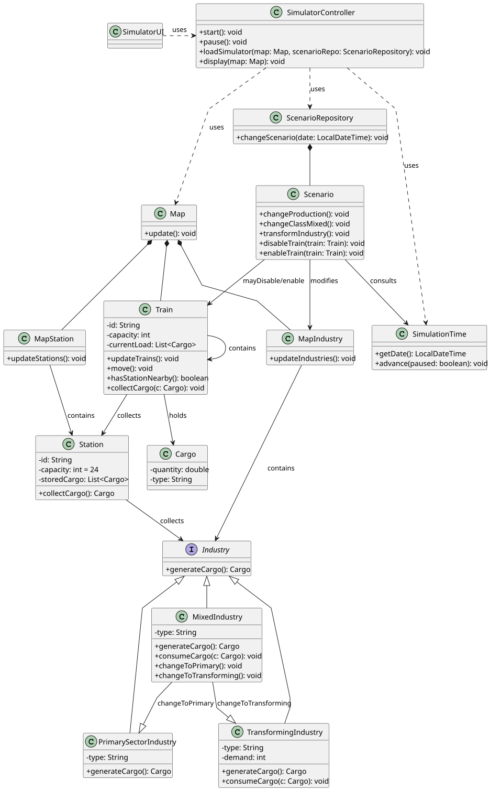

# US012 - Operate a Simulation
## 3. Design

### 3.1. Rationale

| Interaction ID | Question: Which class is responsible for...                          | Answer                   | Justification (with patterns)                                                                                         |
|:---------------|:----------------------------------------------------------------------|:-------------------------|:----------------------------------------------------------------------------------------------------------------------|
| Step 1         | ... interacting with the actor?                                       | SimulatorUI              | Pure Fabrication: interface de utilizador não pertence ao domínio, mas é necessária para interações.                 |
|                | ... coordinating the US?                                              | SimulatorController      | Controller: coordena a simulação, atua como intermediário entre UI e domínio.                                        |
| Step 2         | ... loading simulation with scenario and map?                         | SimulatorController      | Controller: lógica de carregamento coordenada pelo controlador.                                                      |
|                | ... providing access to the current scenario?                         | RepositorieScenario      | IE: centraliza todos os cenários disponíveis para a simulação.                                                       |
| Step 3         | ... knowing the current state of the map?                             | Map                      | IE: representa o estado corrente da simulação no espaço geográfico.                                                  |
| Step 4         | ... managing time progression in simulation steps?                    | SimulationTime           | IE: controla o tempo interno da simulação.                                                                           |
| Step 5         | ... triggering scenario-based changes (e.g. disable train)?           | Scenario                 | IE: define as regras do cenário e os seus efeitos no jogo.                                                           |
|                | ... deciding production logic per industry type?                      | Industry subclasses      | IE: cada subtipo sabe como produzir, em especial MixedIndustry que muda comportamento dinamicamente.                |
| Step 6         | ... generating cargo in all industries?                               | Industry                 | IE: responsável por gerar carga com base na produção e procura.                                                      |
| Step 7         | ... collecting cargo from nearby industries?                          | Station                  | IE: sabe o seu alcance e como recolher carga até ao limite de 24.                                                    |
| Step 8         | ... moving trains and collecting cargo en route?                      | Train                    | IE: sabe a sua rota e como interagir com as estações.                                                                |
| Step 9         | ... displaying updated map and feedback to player?                    | SimulatorUI              | IE: a UI é responsável por apresentar o estado atualizado ao jogador.                                                |

### Systematization ##

According to the taken rationale, the conceptual classes promoted to software classes are:

* Player
* Map
* Station
* Train
* RailLine
* Route
* Industry
* PrimarySectorIndustry
* TransformingIndustry
* MixedIndustry
* Scenario
* Simulation
* City
* Cargo
* Locomotive
* Carriage
* Location
* Period

Other software classes (i.e. Pure Fabrication) identified:

* SimulatorUI
* SimulatorController
* RepositorieScenario
* SimulationTime
* UserSession

## 3.2. Sequence Diagram (SD)

### Full Diagram

This diagram shows the full sequence of interactions between the classes involved in the realization of this user story.

### Split Diagrams

## 3.3. Class Diagram (CD)

