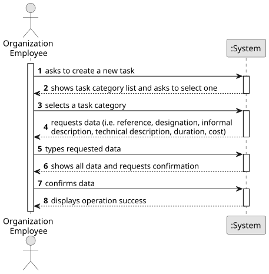

# US014 - Generate a Maintenance Route

## 1. Requirements Engineering

### 1.1. User Story Description

As a Player, given a railway with stations and railway lines, I want to see a route that passes once, and only once, by each railway line to carry out maintenance on the lines.

### 1.2. Customer Specifications and Clarifications 

**From the specifications document:**

>	Each task is characterized by having a unique reference per organization, a designation, an informal and a technical description, an estimated duration and cost, as well as a task category. 

>	As long as it is not published, access to the task is exclusive to the employees of the respective organization. 

**From the client clarifications:**

> **Question:** What kind of unit performs the maintenance route? can it be any kind of train? is there a specific train configuration that needs to be setup by the player?
>
> **Answer:** Any kind of train will be good.

> **Question:** 
>
> **Answer:**

### 1.3. Acceptance Criteria

* **AC1:** The player should be able to choose between the maintenance of all the lines, or only the electrified ones.
* **AC2:** A warning message should be displayed in case it is not possible to get such route. If possible, the station(s) where the route can start, should be displayed so that the player may select it.
* **AC3:** A visualization of the rail network (stations, railway lines) should be displayed to the player (using, for example, Graphviz or GraphStream packages), where electrified railway lines are drawn with a different color from the others.
* **AC4:** All implemented procedures (except the used for graphic visualization) must only use primitive operations, and not existing functions in JAVA libraries.
* **AC5:** The algorithm(s) implemented to solve this problem should be documented/detailed in the repository documentation, using markdown format.

### 1.4. Found out Dependencies

* There is a dependency on "US001 - Create a Map" as there must be a map so that you can create a route.
* There is a dependency on "US005 - Build a Station" as there must at least two station to build a railway line and then generate a route.
* There is a dependency on "US008 - Build a Railway Line" as there must be a railway line between stations so that you can generate a route.

### 1.5 Input and Output Data

**Input Data:**

* Typed data:
    * a reference
    * a designation 
    * an informal description
    * a technical description
    * an estimated duration
    * an estimated cost
	
* Selected data:
    * a task category 

**Output Data:**
* List of existing task categories
* (In)Success of the operation

### 1.6. System Sequence Diagram (SSD)

**_Other alternatives might exist._**

### 1.7 Other Relevant Remarks

* N/A