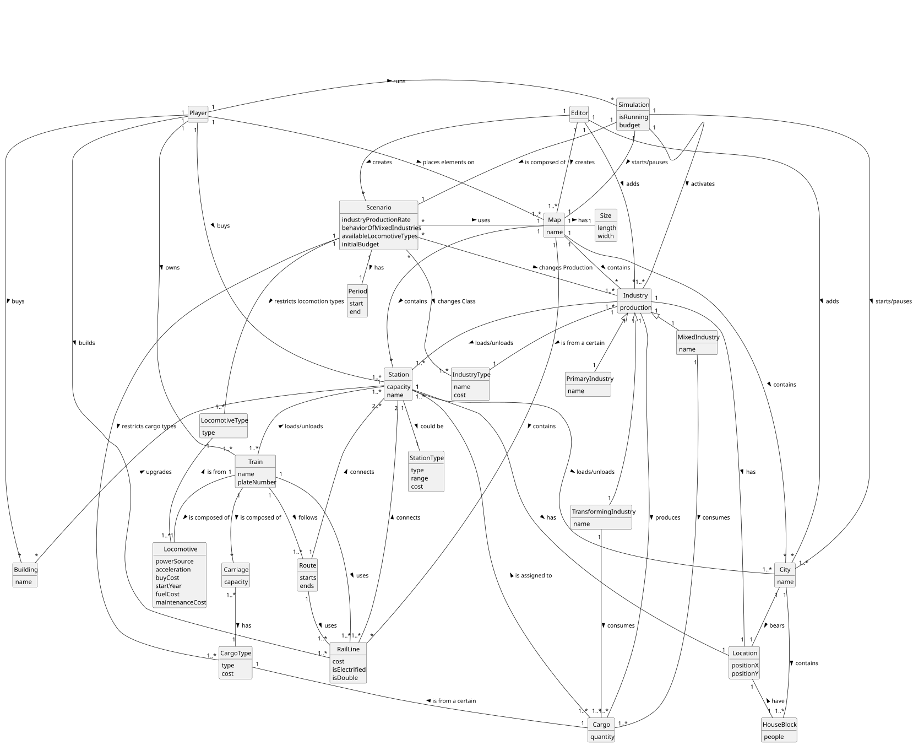

# OO Analysis

The construction process of the domain model is based on the client specifications, especially the nouns (for _concepts_) and verbs (for _relations_) used.

## Rationale to identify domain conceptual classes
To identify domain conceptual classes, start by making a list of candidate conceptual classes inspired by the list of categories suggested in the book "Applying UML and Patterns: An Introduction to Object-Oriented Analysis and Design and Iterative Development".

### _Conceptual Class Category List_

**Business Transactions**

* Player builds Station
* Player builds RailLine
* Player buys Locomotive
* Player assigns Train to Route
* Player upgrades Station

---

**Transaction Line Items**

* Locomotive purchase
* RailLine segment built
* Station built 
* Station Upgrade purchase

---

**Product/Service related to a Transaction or Transaction Line Item**

* Locomotive (as product)
* RailLine (as infrastructure service)
* Station (as infrastructure service)
* Station Upgrade (as service/product)
* Train (with Locomotive and Carriages as products)

---

**Transaction Records**

* Purchase log (e.g., Locomotive bought by Player)
* Construction log (Stations and RailLines built)
* Train assignments (Trains assigned to Route)

---

**Roles of People or Organizations**

* Player
* Editor
* Simulator (as system role)

---

**Places**

* Map
* City
* Station

---

**Noteworthy Events**

* Scenario definition/change
* Industry production change
* Station upgrade
* Train assignment to Route

---

**Physical Objects**

* Station
* Train
* Locomotive
* Carriage
* RailLine
* Industry
* House Block

---

**Descriptions of Things**

* Map (Size, Name)
* Station (Name, Building, Upgrades)
* Train (Name, PlateNumber)
* Locomotive (PowerSource, Acceleration, Cost)
* Carriage (CargoType, Capacity)
* RailLine (Cost, Type)
* Cargo (Type, Quantity, Limit)
* Location (PositionX, PositionY)

---

**Catalogs**

* List of Available Locomotives
* List of (Owned) Trains
* List of (Built) Stations
* Scenario parameters (e.g., Locomotion Types, Port Behavior)

---

**Containers**

* City (contains House Blocks)
* Map (contains Cities, Industries, RailLines, Stations)
* List (contains Available Locomotives, Trains, Stations)

---

**Elements of Containers**

* House Blocks (within City)
* Industries / Cities / Stations (within Map)
* Available Locomotives / Trains / Stations (within List)

---

**Organizations**

* N/A 

---

**Other External/Collaborating Systems**

* Editor (editing tool)

---

**Records of finance, work, contracts, legal matters**

* Player’s budget tracking
* Construction cost records

---

**Financial Instruments**

* Player budget
* Infrastructure investments

---

**Documents mentioned/used to perform some work**

* Integrative Project Assignment pi-sem2-2024-25 - version 1.1
* "Railroad Tycoon II,"Fandom, [Online].Available: https://railroad-tycoon.fandom.com/wiki/Railroad_Tycoon_II. [Accessed: 06-Apr-2025].
* Larman, C. (2004). Applying UML and Patterns (3rd ed.). Prentice Hall. ISBN: 978-0-131-48906-6

## Rationale to identify associations between conceptual classes

An association is a relationship between instances of objects that indicates a relevant connection and that is worth of remembering, or it is derivable from the List of Common Associations:

- **_A_** is physically or logically part of **_B_**
- **_A_** is physically or logically contained in/on **_B_**
- **_A_** is a description for **_B_**
- **_A_** known/logged/recorded/reported/captured in **_B_**
- **_A_** uses or manages or owns **_B_**
- **_A_** is related with a transaction (item) of **_B_**
- etc.

| Concept (A)   |    Association     |                        Concept (B)                         |
|---------------|:------------------:|:----------------------------------------------------------:|
| Editor        |      creates       |                            Map                             |
| Editor        |        adds        |                       Industry, City                       |
| Editor        |      creates       |                          Scenario                          |
| Map           |        has         |                            Size                            |
| Map           |      contains      |                  Industry, City, RailLine                  |
| Industry      |       can be       | PrimarySectorIndustry, TransformingIndustry, MixedIndustry |
| Industry      |        has         |                          Location                          |
| Industry      |   loads/unloads    |                          Station                           |
| Industry      |      produces      |                           Cargo                            |
| List          |      contains      |                           Train                            |
| List          |      contains      |                          Station                           |
| City          |      contains      |                         HouseBlock                         |
| City          |       bears        |                          Location                          |
| City          |   loads/unloads    |                          Station                           |
| Scenario      |        has         |                           Period                           |
| Scenario      |   changes Class    |                       MixedIndustry                        |
| Scenario      | changes Production |                          Industry                          |
| Scenario      |        uses        |                            Map                             |
| Scenario      |     restricts      |                           Train                            |
| MixedIndustry |     transforms     |        PrimarySectorIndustry, TransformingIndustry         |
| Player        |        buys        |               Station, Train, StationUpgrade               |
| Player        |  places elements   |                            Map                             |
| Player        |       builds       |                          RailLine                          |
| Player        |       views        |                            List                            |
| Station       |        has         |                          Location                          |
| Station       |      connects      |                          RailLine                          |
| Station       |      upgrades      |                       StationUpgrade                       |
| Station       |   loads/unloads    |                           Train                            |
| Station       |   is assigned to   |                           Cargo                            |
| Train         |        uses        |                          RailLine                          |
| Train         |      follows       |                           Route                            |
| Train         |   is composed of   |                    Locomotive, Carriage                    |
| Route         |        uses        |                          RailLine                          |
| Route         |      connects      |                    Station (2 or more)                     |
| Simulator     |   starts/pauses    |                          Industry                          |

## Domain Model

**Do NOT forget to identify concept atributes too.**

**Insert below the Domain Model Diagram in a SVG format**

