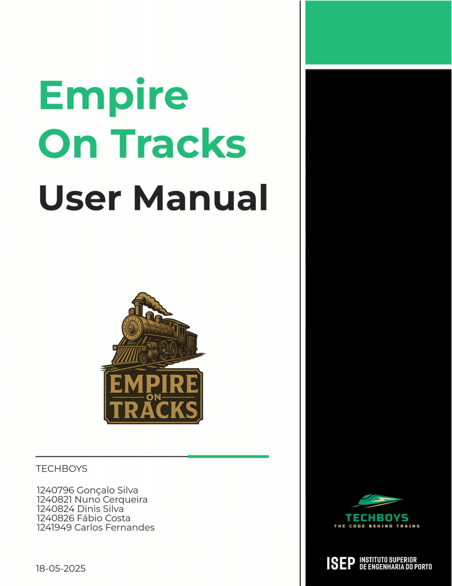

# Empire on Tracks – User Manual

---

## Table of contents

- [Glossary](#glossary)
- [Introduction](#introduction)
- [System Overview](#system-overview)
- [System Requirements](#system-requirements)
- [Features](#features)
- [Troubleshooting & Helpdesk](#troubleshooting--helpdesk)
- [FAQs](#faqs)

---

## Glossary

**Term** | **Definition**
--- | ---
**Budget** | The in-game currency players use to build or upgrade infrastructure.
**City** | An urban location on the map. Cities generate and consume passengers and mail, and they also consume final products (e.g. food, textiles, cars).
**Editor** | A special user role that permits creating, modifying, or customizing scenarios, maps, industries, cities and other game assets.
**Electrified Line** | A rail line equipped to support electric locomotives, requiring overhead catenary and substations.
**FAQs** | Frequently Asked Questions.
**Industry** | A facility on the map that produces, consumes, or transforms cargo. There are three types: Primary Sector (raw resource generators, e.g. coal mines, farms); Transforming Sector (manufacturing plants, e.g. steel mills, bakeries); Mixed Sector (import/export & optional processing, e.g. ports).
**Locomotive** | The engine of the train, responsible for pulling carriages. Varies by power source (steam, diesel, electric), power rating, acceleration, top speed, year introduced, purchase cost, and maintenance cost.
**Map** | The grid-based playing field where players place cities, industries, stations and rail lines.
**Player** | The user who manages a railway empire: building stations, purchasing trains, optimizing routes and overseeing the budget.
**Rail Line** | A track segment connecting two stations or industries. Can be single or double track, and electrified or non-electrified.
**Scenario** | A set of restrictions and conditions applied to a specific map, defining the simulation’s context, including Time Restrictions (start and end dates, e.g. 1900–1950); Technological Restrictions (available locomotive types & industries); Historical Restrictions (scripted events affecting demand, e.g. wars, vaccination campaigns); Port Behaviors (which cargo each port imports, exports, or processes).
**Station** | A building where trains stop to load or unload passengers and/or cargo. Available in three tiers—Depot (3×3 radius; cost 50,000), Station (4×4 radius; cost 100,000), Terminal (5×5 radius; cost 200,000)— stations have upgrade options (café, hotel).
**Train** | A vehicle composed of locomotives together with carriages, used to transport cargo along player-defined routes between stations.

---

## Introduction

Welcome to the *Empire on Tracks* User Manual.

This User Manual is designed to provide clear and practical guidance for users of the *Empire on Tracks* railroad management simulation application.

The objective of this manual is to assist players in understanding, setting up and operating the system. This document serves as an initial guide and as quick reference for common questions as well as a deeper understanding of the application functionalities.

This manual is intended for players and editors, regardless of their familiarity with railway management or simulation software, and it is designed to provide step-by-step support so that they can make the most of their *Empire on Tracks* experience. In this document, users can find a glossary of terms and abbreviations, an outline of the program's main features, its system requirements, typical user interactions, and troubleshooting support as well as responses to frequently asked questions (FAQs).

---

## System Overview

<!-- Content placeholder; was blank in the PDF -->

---

## System Requirements

<!-- Content placeholder; was blank in the PDF -->

---

## Features

<!-- Content placeholder; was blank in the PDF -->

---

## Troubleshooting & Helpdesk

<!-- Content placeholder; was blank in the PDF -->

---

## FAQs

<!-- Content placeholder; was blank in the PDF -->

---
